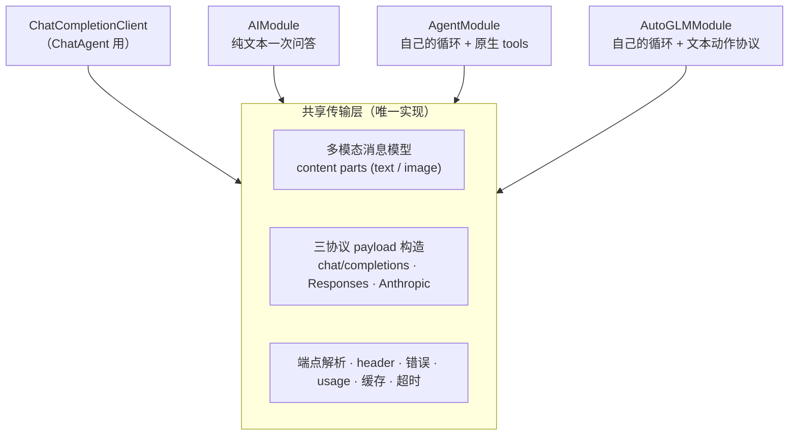

# AI 能力统一：多模态 · 多协议 · 配置引用（设计与任务拆分）

> 版本：v0.2（**讨论稿 · 决策点绝大多数未决**）
> 状态：现状已走查（代码位置逐条核对）；设计空间与任务拆分已列出，**§4 决策点绝大多数留空待议**（**例外**：D5 的「渲染图片」一项已于 2026-10-15 定下「支持」，见 §3.2 方向 ②）
> 对应分支：`dev`（走查日期 2026-10-15）
> 目录归属：fork 独有（上游无此文件，冲突归我方）
> 用途：把「让工作流内的 AI 模块复用 ChatAgent 的请求能力、并支持引用模型配置」这件事的**现状、设计空间、任务拆分**固定成文，供后续详细讨论与拆分任务。
> 相关文档：[`surveys/ai-system-overview.md`](surveys/ai-system-overview.md)（AI 体系现状；其 §7「优化方向」的 **P2「统一密钥/Provider 配置」** 与 **P2「收敛链路 C 的双视觉 Agent」** 与本文件同源，本文件是这两条的具体化）；[`chat-agent-rearchitecture.md`](chat-agent-rearchitecture.md)（ChatAgent 工具架构重构）。
>
> **修订记录**
> - v0.2（2026-10-15）：消歧「模型返回图」（≠ 文生图，见 §3.2 注）；§3.2 增「要覆盖哪几个方向」表；**方向 ②「渲染图片」定案为「支持」**（用户 2026-10-15）；同步 D5 / T2 / R5。
> - v0.1（2026-10-15）：初稿。

---

## 0. 为什么写这份文档

起因是一个具体诉求：项目里 AI 相关的功能太独立，`AutoGLMModule` / `AgentModule` / `AIModule` 底层「请求大模型」的逻辑各自重复实现了一遍，理论上可以复用 **ChatAgent**（目前最完整）；同时希望 AI 模块能**引用「设置 → 模型配置」里的配置**，而不是把 base_url / api_key / model 写死在工作流步骤里，并且**保留手动配置**的能力。

走查后的判断：这不是一个小改动，而是一次牵动 **传输层 / 消息数据模型 / 三协议 / 多模态 / 配置与密钥 / 备份** 的系统性统一。故先落文档。

**本文档基本不做决策**——凡属「应该选哪个」的问题集中在 §4，留空待议；唯一的例外是 D5 里的「渲染图片」（2026-10-15 已定「支持」）。

**证据约定**：本文所有「事实」均附代码位置（行号已回代码核对，但仍会随代码漂移，引用前以代码为准）；凡属「判断 / 建议」均在文中显式标注。

---

## 1. 现状（走查事实）

### 1.1 两条 AI 链路与全部出网点

全仓库 LLM 出网点共 **3 处**（`surveys/ai-system-overview.md` §0 的结论，本轮复核一致）：

| 链路 | 出网点 | 谁驱动 | 能力范围 |
|---|---|---|---|
| **A · 聊天 Agent** | `ui/chat/ChatCompletionClient.kt` | LLM 自主多轮调工具 | 观察屏幕、点按、读写剪贴板、跑工作流 |
| **C · 工作流内 AI 模块** | `core/workflow/module/network/AIModule.kt`、`.../interaction/AgentModule.kt`、`.../interaction/AutoGLMModule.kt` | 工作流执行时调 LLM | 文本问答、视觉 Agent 操作手机 |
| （C 的旁支） | `core/workflow/module/integration/OperitModule.kt` | 转发给外部 Operit App | 不自带提示词、不出网（走 `EXTERNAL_CHAT` Intent） |

> `OperitModule` **不属本文件的复用范围**（它不直接调 LLM）。

### 1.2 ChatAgent 的传输能力（「最完整」体现在哪）

`ChatCompletionClient`（`ui/chat/ChatCompletionClient.kt`，约 1200 行，`internal class`，`:131`）目前具备：

| 能力 | 位置 |
|---|---|
| 5 个 provider 枚举（OpenAI / DeepSeek / Anthropic / OpenRouter / Ollama） | `ChatModels.kt:7` `ChatProvider` |
| **3 种协议**：`chat/completions`、OpenAI **Responses**、Anthropic **messages** | `ChatEndpointResolver.kt`（`ChatEndpointMode`）、`ChatCompletionClient.kt:241`（OpenAI 适配器，含 Responses 分支 `:394`）、`:662`（Anthropic 适配器） |
| 非流式 `generateReply` / 流式 `streamReply` | `:134` / `:178` |
| Anthropic prompt 缓存（`cache_control`） | `:1079` `buildAnthropicToolDefinitions`、`ephemeralCacheControl()` |
| usage / 缓存 token 提取、超时口径统一 | `ChatStreamTimeouts`、`extractTotalTokens` 等 |
| 端点规整（各 provider 的 base_url 归一） | `ChatEndpointResolver.resolve` |

**但它当前只支持纯文本**：`buildChatCompletionHistoryMessages`（`:425`）只产 `{role, content: <string>}`；三条协议都不拼图片 content parts。

### 1.3 三个 AI 模块的重复实现（同源代码三份）

| 模块 id | 类 / 行数 | provider 枚举 | 默认 base_url / model | 请求实现 |
|---|---|---|---|---|
| `vflow.ai.completion` | `AIModule` / 214 | openai / deepseek / custom | `https://api.openai.com/v1` / **`gpt-3.5-turbo`**（`AIModule.kt:74`） | 内联 OkHttp + Gson（`execute` `:107`） |
| `vflow.ai.agent` | `AgentModule` / 693 | dashscope / bigmodel / custom | `https://dashscope.aliyuncs.com/compatible-mode/v1` / `glm-4.6v-flash`（`:133/135`） | 私有 `callLLM`（`:699`，`org.json`） |
| `vflow.ai.autoglm` | `AutoGLMModule` / 682 | bigmodel / custom | `https://open.bigmodel.cn/api/paas/v4` / `autoglm-phone`（`:98/100`） | 私有 `callLLM`（`:695`，`org.json`） |

**逐项重复对照**（判断：全部属「可收敛」）：

| 逻辑 | AIModule | AgentModule | AutoGLMModule | ChatAgent |
|---|---|---|---|---|
| `OkHttpClient.Builder` + 超时 | ✅ 30/60s | ✅ 60/120s | ✅ 60/120s | ✅ 统一 |
| 端点拼接 `$baseUrl/chat/completions` | ✅ 朴素拼接 | ✅ 同 | ✅ 同 | ✅ `ChatEndpointResolver` |
| `Authorization: Bearer` | ✅ | ✅ | ✅ | ✅ |
| payload `{model, messages, temperature}` | ✅ | ✅ | ✅ | ✅ + tools/stream |
| `choices[0].message.content` 解析 | ✅ | ✅ | ✅ | ✅ + usage/缓存 |
| provider 默认 base_url / model 硬编码 | ✅ | ✅ | ✅ | ✅ 枚举集中 |
| **代理（proxy）** | ✅ 有 | ❌ 无 | ❌ 无 | —（不适用） |
| 多协议（Responses / Anthropic） | ❌ | ❌ | ❌ | ✅ |
| 多模态（图片） | ❌ | ✅ 自实现 | ✅ 自实现 | ❌ |
| 原生 function calling | ❌ | ✅ 自实现 | ❌（用文本协议） | ✅ |
| usage / 缓存 / 流式 | ❌ | ❌ | ❌ | ✅ |

> 模块侧唯一的「共享 helper」先例是网络模块的 `moduleProxyInputDefinitions()` / `applyProxyIfConfigured()`（`core/workflow/module/network/PushModuleSupport.kt:81` / `:23`）——但**只有 `AIModule` 用了**，两个视觉 Agent 没接。

### 1.4 多模态「预留」的真实状态：只有 UI 一层

用户观察到「对话框可以选图片」，属实；但**预留只到 UI 为止**，链路下面四层全空：

| 层 | 状态 | 证据 |
|---|---|---|
| UI 附件面板（相册 / 拍照 / 权限 / 多选 / 预览） | ✅ **已实现** | `ChatScreen.kt:686`（入口 `IconButton`）、`:802`（`ChatAttachmentSheet`）、`:364` / `:378`（两个 `rememberLauncherForActivityResult`） |
| 发送路径 | ❌ 只收文本 | `ChatViewModel.sendMessage(prompt: String)`（`ChatViewModel.kt:379`）；附件被丢弃并弹提示 `chat_attachment_not_supported`（`ChatScreen.kt:706-711`；文案 `values/strings.xml:76`「当前版本先支持文本对话，附件暂时不会发送给模型。」） |
| 消息数据模型 | ❌ **无字段** | `ChatMessage`（`ChatModels.kt:193`）只有 `content: String`（`:196`），无 attachment / content-parts |
| 请求构造 | ❌ 只拼文本 | `ChatCompletionClient.buildChatCompletionHistoryMessages`（`:425`） |
| 消息渲染 | ❌ 只画文字 | `UserMessageBubble`（`ChatScreen.kt:1259`）只渲染 `message.content` |
| 持久化 / 备份 | ❌ 无 | `ChatSessionState` 无图片位；备份 `ChatScope`（`core/backup/scopes/ChatScope.kt`）未考虑 |

> `selectedPhotoUris` / `capturedPreview` 是**纯 Compose 局部状态**（`ChatScreen.kt:327-328`），发送后即 `clear()`。
> **结论**：加多模态的真实工作量在**下面四层**，UI 反而是现成可用的。

### 1.5 ChatAgent 截图后到底看到什么（回答「调试时截图会怎样」）

以 `vflow.system.capture_screen`（`CaptureScreenModule.kt:48`，输出 `image`（`VImage`），`:110`）为例：

1. 模块执行成功 → `ChatAgentArtifactStore.createReferences()`（`ChatAgentModuleExecutor.kt:76`）把 `VImage` 存进内存表（`:73`），生成句柄 `artifact://<callId>/image`；
2. 回给模型的 tool result 文本由 `buildSuccessOutputText`（`:2919`）拼：
   ```
   Tool `截屏` completed successfully.

   Outputs:
   - image: image artifact available            ← summarizeOutputValue 对 VImage 的固定文案（:3033）

   Artifacts:
   - image (image): artifact://call_xxx/image   ← 不透明句柄
   ```
3. **模型看到的就是 `image artifact available` 这个字符串 + 一个句柄，看不到任何像素。**

**因此**：

- 模型**无法「读」截图**；若据此继续推理，只能是幻觉或放弃。
- 唯一可行路径是**两步**：`call_module(vflow.interaction.ocr, {image: "artifact://…"})`——句柄经 `coerceInputValue` / `resolveArtifactValue`（`:2871` / `:2886`）解析回真正的 `VImage`，任何输入类型都支持。
- 这印证了 `ai-system-overview.md` §2.3 的「截图 / OCR 仅作**显式兜底**」——**视觉兜底从来不是「让模型看图」，而是「截图 → OCR → 文字」**。
- 主路径不靠截图：`vflow_agent_observe_ui` 返回**无障碍节点树**（纯文本），完整可用。

**两个附带边界**：句柄按**每次调用**临时生成（`artifact://<callId>/…`）；且**不允许写进工作流**（`ChatAgentModuleExecutor.kt:1097` 会拒绝）。

### 1.6 AutoGLM 的「协议」（走查结论：传输协议与动作协议是两回事）

| 维度 | `AgentModule` | `AutoGLMModule` |
|---|---|---|
| **HTTP 协议** | OpenAI 兼容 `chat/completions` | **同样** OpenAI 兼容 `chat/completions`（`callLLM` `:695`） |
| **动作协议** | **原生 function calling**（8 个 `tools` schema，`getNativeToolsSchema` `:215`，`tool_choice: "auto"` `:524`） | **纯文本中文协议**：`<answer>do(action="Tap", element=[x,y])</answer>`，用标签 / 正则解析（系统提示词 `:262` 起） |
| 坐标尺度 | 0–1000 | 0–999 |
| 多模态 | ✅ `image_url` base64（`:488-489`） | ✅ `image_url` base64（`:368-370`） |
| 历史图片 | 保留 | **每步之后主动删除**图片、留 `[Image removed]`（`:403-410`），省 token |

> **判断**：AutoGLM 的特殊性在于它**不依赖模型的 function calling 能力**（这正是它存在的意义，可跑在不支持工具调用的模型上），但**需要多模态**。⇒ 它**不能**直接套用 ChatAgent 的 `tools` 路径，但它的**传输层**（端点 / header / payload / 多模态 / 错误解析）**可以**共用。

### 1.7 密钥与备份现状（「引用配置」的额外价值）

- AI 模块的 `api_key` 是**工作流步骤参数**，随 `workflows` scope 导出，**绕过 `secrets` 的勾选**——目前靠 `SecretFieldScrubber` 兜底：其 `SCRUB_SUBSTRINGS`（`core/backup/SecretFieldScrubber.kt:53`）含 `"api_key"`，注释点名「三个 AI 模块」（静默失效点 6）。
- 聊天侧配置存在 `module_config_prefs` 的 `chat_provider_configs_json` / `chat_presets_json`（`ChatPresetRepository.kt:14-15`），**含 apiKey**，因此被 `SecretsScope.SECRET_SLOTS` 收进「需口令加密」的密钥范围（`core/backup/scopes/SecretsScope.kt`）；`ChatScope` 明确**不含**这两个键。
- ⇒ **「引用配置」会让 api_key 根本不进工作流**：不再依赖清洗兜底，明文导出 / 分享工作流也安全。这是一项独立的收益（判断）。

---

## 2. 目标（三个能力，正交但互相咬合）

1. **多模态（图片输入 / vision）**：ChatAgent 支持图片**输入**（用户发图 / Agent 截图直接进模型），并把这份能力开放给 AI 模块。⚠️ **不含「文生图」**——那是另一项能力，见 §3.2 的注。
2. **多协议同步**：AI 模块与 ChatAgent **共用同一套传输实现**，从而「一次改动处处生效」（新 provider、新协议、缓存、超时、重试等）。
3. **配置引用**：AI 模块可**引用**「模型配置」里的配置（而非把配置写进工作流），**并保留手动配置**。

> 三者的依赖关系（判断）：**多模态是共用传输层的前置条件**（ChatAgent 附件、Agent 截图、AutoGLM 截图三个需求其实指向同一处）；**配置引用与传输层改造正交**，可并行。

---

## 3. 设计空间（列出选项，不决策）

### 3.1 共享边界定在哪

**建议（判断）**：共享边界 = **「一次 LLM 往返」**，而非整个 Agent 循环。



- **应共享**：端点 / header / payload / 响应解析 / 多模态 / 错误 / usage / 缓存 / 超时。
- **不应共享**：Agent / AutoGLM 各自的**循环**（截图节奏、动作解析、终止条件）——那是它们各自的核心价值。
- **要成为「唯一实现」**：共享层不能是「新包一层 + 旧实现还在」——那会让「一次改动处处生效」落空。这是本改造的硬约束。

### 3.2 多模态的数据模型（选项）

> ⚠️ **本节只讨论「图片输入」的承载**（vision：把图喂给模型），**不是「文生图」**。后者是**独立能力**——走不同的 API 面（OpenAI `/v1/images/generations`、或 Responses 的 `image_generation` 工具；Anthropic 无；各家支持不一），不经过 chat 消息的 content parts，与本文件的三个目标无交集，更可能是一条新模块或 ChatAgent 的新工具，**不在本文件范围**。
>
> 本节要定的其实是**数据模型的覆盖面**（三个方向，见下），其中只有「模型原生在回复里回图」勉强能叫「模型返回图」，且它与文生图是两回事。

| 选项 | 形态 | 取舍 |
|---|---|---|
| **A** `ChatMessage` 加 content-parts | `content` 由 `String` 变为「文本 + 附件」列表 | 语义最正；改动面最大（持久化 / 渲染 / 备份全动） |
| **B** `ChatMessage` 加独立 `attachments` 字段 | 保留 `content: String`，另加图片引用列表 | 改动局部；但「文本 + 图」的**交错顺序**表达不了 |
| **C** 附件只在**请求构造期**注入 | 消息模型不动，运行时把图拼进 payload | 改动最小；但**历史 / 渲染 / 备份**都留不住图 |

**要覆盖哪几个方向**（与上面 A/B/C 正交）：

| 方向 | 具体是什么 | 现状 | 必要性（判断） |
|---|---|---|---|
| ① 输入：USER 消息带图 | 用户发图给模型 | 未实现（§1.4） | **必做** |
| ② 工具产出的图渲染进对话 | Agent 截图（`VImage`）在对话里渲染成图片**给人看** | 未实现（tool result 只渲染文本行） | ✅ **支持**（用户 2026-10-15 定） |
| ③ 输出：ASSISTANT 消息带图 | 模型**原生在回复里返回图片** content part（如 Gemini 系） | 未实现 | 待定（罕见） |

> ① 决定「能不能用图」（其 UI 侧——在用户气泡里渲染所发图片——与 ② 同属「渲染」范畴）；② 决定「用户能不能在图里看见 Agent 看到的东西」（**已定：支持**）；③ 决定数据模型是否双向。
>
> ⚠️ **② 的一个实现前提**：工具产出的图是 `VImage`，只存在于**内存里的 `ChatAgentArtifactStore`**，句柄 `artifact://<callId>/<key>` 按每次调用生成（`ChatAgentModuleExecutor.kt:73/76`）。要「渲染进对话」，得先解决**句柄如何从内存活到渲染期**（以及是否随会话持久化）——见 §6 的 R5。

### 3.3 通用工具 schema 通道（选项）

现状：`ChatCompletionClient` 的工具装配只认 `ChatAgentToolDefinition`（`ChatAgentToolRegistry.kt:21`，含 `moduleId` / `riskLevel` / `usageScopes` 等 Agent 专有字段；装配见 `ChatCompletionClient.kt:1040` / `:1079`）。

| 选项 | 形态 | 取舍 |
|---|---|---|
| **A** 泛化工具定义类型 | 抽一个中性的 `AiToolSchema`，Agent 侧做适配 | 最干净；动 Agent 侧类型（diff 大） |
| **B** 加一条 raw-schema 通道 | 共享层同时接受「已装配好的 schema JSON」 | 改动小；存在两条工具入口，需防走偏 |
| **C** 不共享工具路径 | 只有 `AIModule` 走共享层，两个视觉 Agent 保留自实现工具 | 最省事；但「一次改动处处生效」对两个 Agent 不成立 |

### 3.4 共享层的落点（选项）

> 前提事实：`ui/chat` 与 `core/workflow/module` **同属 `:app` 模块**（`core` 只是包名约定，不是编译边界），`internal` 可跨包访问。所以「core → ui」只是分层观感问题，不阻塞编译。

| 选项 | 形态 | 取舍 |
|---|---|---|
| **甲** 就地改 `ChatCompletionClient` | 在现文件补多模态 + 通用工具，AI 模块 import `ui.chat` | diff 收敛到一处；但该文件**是上游文件且已认手动合并**（`FORK.md` 有登记），重构面最大 |
| **乙** 抽到 fork 新包（如 `core/ai/`） | 通用传输迁到中性包，`ChatCompletionClient` 变为消费者 | diff 可控、不碰上游语义；需迁移，且短期「新层 + 旧层」并存 |

### 3.5 配置引用（选项）

| 维度 | 选项 |
|---|---|
| **引用粒度** | (a) 引用 `ChatPresetConfig`（**含 model 名**，`ChatModels.kt:73`）；(b) 引用 `ChatProviderConfig`（**不含 model**，`:57`）+ 另填 model |
| **参数形态** | `config_source` ENUM `{manual, reference}`（**默认 manual** ⇒ 零迁移）+ `model_config_id` STRING |
| **systemPrompt / temperature 是否跟随** | (a) 全部跟随；(b) 只跟随 provider/model/key/temperature，**不取 systemPrompt**（视觉 Agent 的系统提示词是内置协议，不能覆盖） |
| **UI 形态** | 照 `CallWorkflowModuleUIProvider`（`core/workflow/module/logic/CallWorkflowModuleUIProvider.kt`）的「选择按钮 + `SearchableWorkflowDialog`」先例做实体选择器 |
| **被引用配置被删除** | (a) 阻止删除；(b) 允许删除 + 运行时明确报错；(c) 提示但不阻止 |
| **模型配置页是否显示引用计数** | 是 / 否 |

---

## 4. 待决策清单（**全部未决**）

> 用户明确表示「这些决策点先不决策」，此处仅登记，供后续讨论。

| # | 决策点 | 选项（见上） | 影响面 | 状态 |
|---|---|---|---|---|
| D1 | 共享边界是否定为「一次 LLM 往返」 | §3.1 | 全局架构 | ⬜ 待议 |
| D2 | 多模态数据模型 | §3.2 A/B/C | 数据模型 / 渲染 / 持久化 / 备份 | ⬜ 待议 |
| D3 | 通用工具 schema 通道 | §3.3 A/B/C | 两个视觉 Agent 的共用程度 | ⬜ 待议 |
| D4 | 共享层落点 | §3.4 甲/乙 | diff 面积 vs 收敛度 | ⬜ 待议 |
| D5 | 多模态数据模型的**覆盖面** | §3.2 | `ChatMessage` 模型设计 / 渲染 | 🔶 部分已定：① 必做、② **已定支持**（2026-10-15）；③ 待议 |
| D6 | 配置引用粒度（preset vs provider） | §3.5 | 参数设计 | ⬜ 待议 |
| D7 | systemPrompt / temperature 是否跟随引用 | §3.5 | 视觉 Agent 行为正确性 | ⬜ 待议 |
| D8 | 被引用配置删除时的行为 | §3.5 | 健壮性 | ⬜ 待议 |
| D9 | 图片的持久化与备份策略（存路径 vs base64） | §3.2 | 会话体积 / 备份体积 | ⬜ 待议 |
| D10 | 是否顺带对齐 `AIModule` 的过时默认模型 `gpt-3.5-turbo` | §1.3 | 兼容性 | ⬜ 待议 |

---

## 5. 任务拆分（**草案**，供后续细化）

> 依赖关系（判断）：`T1 → T2`；`T1 → T3`；`T1 + T3 → T4`；`T4 → T5/T6/T7`；`T8` 与 `T1` 正交，可并行。

| 任务 | 内容 | 依赖 | 备注 |
|---|---|---|---|
| **T1** | 多模态数据模型 + 传输：`ChatMessage` 升级（按 D2）、`ChatCompletionClient` 三条协议支持图片 content parts | — | **共用传输层的前置条件** |
| **T2** | 多模态 UI 接线：发送路径传附件、**渲染**（用户所发图片 + **工具产出的图**，见 §3.2 方向 ②）、持久化、备份影响评估 | T1 | 用户直接可见的部分 |
| **T3** | 通用工具 schema 通道（按 D3） | T1 | 决定两个视觉 Agent 能否共用 |
| **T4** | 抽共享「一次 LLM 往返」入口（按 D4）；ChatAgent 行为保持不变（回归） | T1, T3 | 本改造的枢纽 |
| **T5** | `AIModule` 改走共享入口（纯文本一次问答，保留 `system_prompt`） | T4 | **难度最低、收益最大**，建议先做 |
| **T6** | `AgentModule` 改走共享入口（多模态 + 原生 tools，保留自己的循环） | T4 | 需回归 `tool_choice` 等 fork 既有改动 |
| **T7** | `AutoGLMModule` 改走共享入口（多模态 + 文本动作协议，**不走 tools 路径**） | T4 | 保留自己的动作解析与图片清理 |
| **T8** | 配置引用：新增参数 + resolver + UI 选择器 + 三个模块接入 + 备份/密钥影响 | 独立 | 与 T1 并行；落地后 `api_key` 不再进工作流 |

---

## 6. 风险与静默失效点（走查所得）

| # | 风险 | 说明 |
|---|---|---|
| R1 | **「新层 + 旧实现并存」** | 若共享层只是 wrapper 而旧实现未撤，则「一次改动处处生效」落空——本改造最容易失败的方式 |
| R2 | **`ChatCompletionClient` 是已认手动合并的上游文件** | 重构它是本任务最大的 diff 来源（FORK.md 有登记） |
| R3 | **端点规整行为变化** | 模块现在是朴素 `$baseUrl/chat/completions`，改用 `ChatEndpointResolver` 后规整规则变了（多数 base_url 结果相同，但需回归） |
| R4 | **视觉 Agent 的图片历史策略** | AutoGLM 每步删图省 token（`AutoGLMModule.kt:403`），共用传输层时**不能**把这套策略一并上收 |
| R5 | **`artifact://` 句柄生命周期** | 句柄按每次调用临时生成、且不允许写进工作流。**方向 ②（把工具产出的图渲染进对话）直接踩在这里**：图只在内存 artifact store 里，句柄要活到渲染期（且可能要跨会话持久化）——需专门设计，否则「历史消息里的图」会失效成空白 |
| R6 | **引用配置被删 / 被改** | 工作流行为随模型配置变化，是「引用」的固有代价，需按 D8 处理 |
| R7 | **备份体积** | 会话图片若进 `chat_session_prefs` 会显著撑大备份（`ChatScope` 已因体积默认不勾选会话历史） |
| R8 | **`AIModule` 默认模型过时** | `gpt-3.5-turbo`（`AIModule.kt:74`）与 ChatAgent 默认（`gpt-5.4`）严重不同步 |

---

## 7. 下一步

1. 本文档评审：确认 §4 各决策点（尤其是 D1 / D2 / D4）。
2. 决策收敛后，把 §5 的 T1–T8 拆成独立任务（每个任务单独出一份实现稿 / 直接进实现）。
3. 建议的起步顺序（判断）：**T1（多模态）→ T5（AIModule 接入）** 先打通一条端到端链路，验证「一次改动处处生效」是否成立，再推 T6 / T7。

---

## 附录 A：关键文件索引

| 关注点 | 文件 |
|---|---|
| ChatAgent 请求构造 / 三协议 / 适配器 | `ui/chat/ChatCompletionClient.kt` |
| 端点规整 | `ui/chat/ChatEndpointResolver.kt` |
| 聊天数据模型（provider / preset / message） | `ui/chat/ChatModels.kt` |
| 配置读写与持久化 | `ui/chat/ChatPresetRepository.kt` |
| 工具定义类型 | `ui/chat/ChatAgentToolRegistry.kt` |
| 工具结果 → 模型输入的格式化（含 artifact 段） | `ui/chat/ChatCompletionClient.kt`（`ChatToolResultInputFormatter`） |
| Agent 侧 artifact 存储 / 输出摘要 | `ui/chat/ChatAgentModuleExecutor.kt` |
| 聊天 UI（附件面板 / 消息渲染） | `ui/chat/ChatScreen.kt` |
| 工作流内 AI 模块 | `core/workflow/module/network/AIModule.kt`、`.../interaction/AgentModule.kt`、`.../interaction/AutoGLMModule.kt`、`.../integration/OperitModule.kt` |
| 模块侧共享 helper 先例（代理） | `core/workflow/module/network/PushModuleSupport.kt` |
| 实体选择器先例 | `core/workflow/module/logic/CallWorkflowModuleUIProvider.kt` |
| 工作流密钥清洗 | `core/backup/SecretFieldScrubber.kt` |
| 备份范围（聊天 / 密钥） | `core/backup/scopes/ChatScope.kt`、`core/backup/scopes/SecretsScope.kt` |

## 附录 B：与既有文档的关系

- `surveys/ai-system-overview.md` §7 的 **P2「统一密钥/Provider 配置」** 与 **P2「收敛链路 C 的双视觉 Agent」** 是本文的**上游条目**；本文把这两条具体化为「多模态 + 多协议 + 配置引用」的一次性设计。
- `chat-agent-rearchitecture.md` 描述的是 ChatAgent **工具暴露**架构（72→16 工具）；本文改的是**传输层与数据模型**，两者不重叠，但 T4 会触及同一个 `ChatCompletionClient`，实施时需协调。
