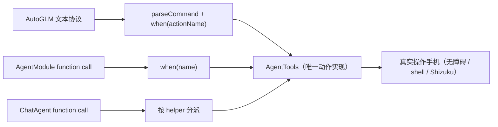
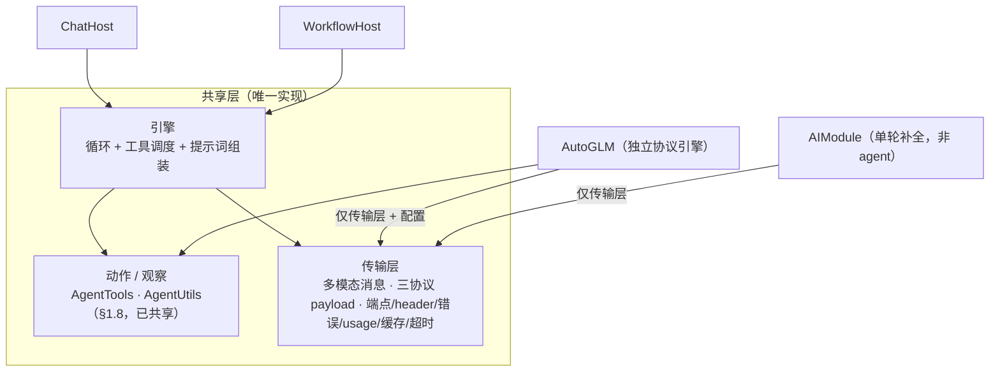
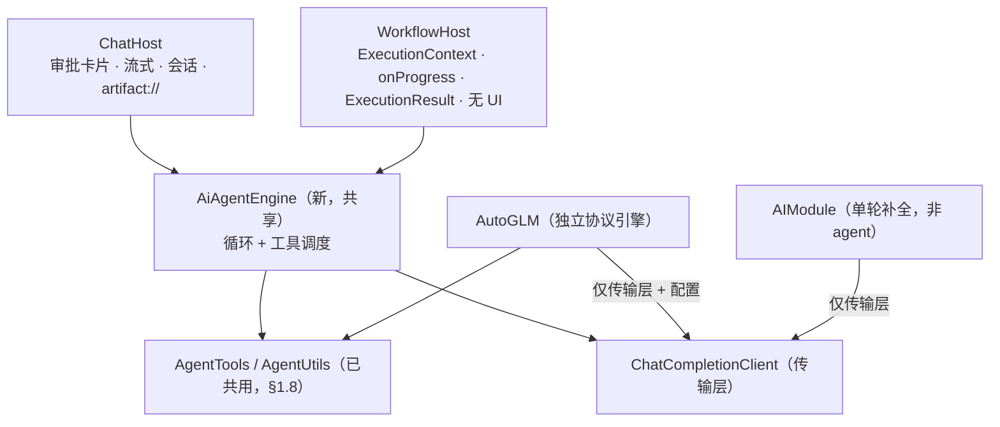

# AI 能力统一：多模态 · 多协议 · 配置引用（设计与任务拆分）

> 版本：v0.15（**已开工 · 批 1 已合入 `dev`**）
> 状态：现状已走查（代码位置逐条核对）。**结构性阻塞点已全部定案**（**D4 共享层落点 = 甲**、**D11 `AgentHost` 边界**）⇒ **T4 / T9 可拆**。已定 / 已修订：**D1** 共享边界 = 动作层 + 传输层 + **引擎**；**D4** = 甲（`ui/chat/`，不搬上游文件）；D5「渲染图片」= 支持；**D6** 引用 = 活引用 + 值拷贝；D7 值拷贝 systemPrompt；**D11** `AgentHost`（§3.11）；D12 白名单 + 自动放行、不设替代提示；**D13** 分段；D14 观察输入可配置（方向）；D16 规则段抽公共段 + 宿主专属段；**D17** 循环上限四项；**D19** 图片预算；**D20** 坐标改归一化；**D21** 图片展示 = 正文内联引用（pin 已否决）。详见 §3.1 / §3.4–§3.11
> 对应分支：`dev`（走查日期 2026-10-15；**批 1 落地 2026-10-16**，提交 `3f5f97cc`）
> 目录归属：fork 独有（上游无此文件，冲突归我方）
> 用途：把「让工作流内的 AI 模块复用 ChatAgent 的请求能力、并支持引用模型配置」这件事的**现状、设计空间、任务拆分**固定成文，供后续详细讨论与拆分任务。
> 相关文档：[`surveys/ai-system-overview.md`](surveys/ai-system-overview.md)（AI 体系现状；其 §7「优化方向」的 **P2「统一密钥/Provider 配置」** 与 **P2「收敛链路 C 的双视觉 Agent」** 与本文件同源，本文件是这两条的具体化）；[`chat-agent-rearchitecture.md`](chat-agent-rearchitecture.md)（ChatAgent 工具架构重构）。
>
> **修订记录**
> - v0.15（2026-10-16）：**批 1 落地回填** —— §1 现状按已交付部分订正（§1.2 传输能力已含图片 + 中性 schema；§1.4 六层状态表更新；§1.7 会话持久化已改）；§3.2 / §3.3 / §3.7 标「已实现」；§4 台账 **D2 / D3 已定（均取 B）并已实现**、D19 已实现；**§5 新增 §5.1 交付状态与分批结论**（⚠️ 原「T2 ∥ T4 可并行」被推翻 ⇒ 改 4 批；**D20 归属订正到批 2**）；新增 **§3.7.8**（`generateReply` 丢失 `withContext(IO)` 的真回归与教训）。代码见 `dev` 提交 `3f5f97cc`，分歧登记见 `FORK.md`「AI 能力统一 · 批 1」。
> - v0.14（2026-10-15）：**D4 / D11 定案** —— 新增 **§3.11 `AgentHost` 接口草案**（8 成员 / 取消不入接口 / artifact 必需 / 两宿主差异表 / 不拆 ISP 的理由）；§3.4 改写为 **D4 已定「甲」**（含搬运成本实测：`ui/chat` 33 文件 20,359 行、上游 17 个；**只 import 不搬**的合并代价对照）。⚠️ **结构性阻塞点清空** ⇒ T4 / T9 可拆。另修正 §3.10.3：**监视器与轨迹不能合并**（用户明确）。
> - v0.13（2026-10-15）：新增 **§3.9「图片的展示与保存」**（**pin 方案被否决** ⇒ 改用**正文内联引用**；规则 = **引用即保存**；判据从主观变客观 ⇒ **消掉「零 pin / 全 pin」两种失败形态**；现状「**现在没接图片加载**」；四项待补工作；**句柄长度**问题）与 **§3.10「轨迹视图」**（dsh 的 `ui-trajectory` 逐文件走查；与运行监视器的分工；瘦身版/完整版规模评估）。新增 **D21（已定）/ D22 / D23**。
> - v0.12（2026-10-15）：**D19 / D20 定案** —— D19：默认不缩 + base64 ≤5MB 兜底 + Agent 截图 1–3 / 用户图 5（不设合计上限）；D20：ChatAgent 的 `tap_screen` / `long_press_screen` 改为**归一化（0–1000）**，列为 T1 验收项（⚠️ 属已发布 schema 的行为变更）。
> - v0.11（2026-10-15）：**修正 §3.7.4 的一处自相矛盾** —— 删掉「每请求合计 ≤6 张」（与分类上限 3+5=8 冲突，且冲突时**无依据决定先裁谁**）；§3.8 补「**什么是归一化坐标**」（对比表 + 换算 + 三情形例子 + 精度）。
> - v0.10（2026-10-15）：新增 **§3.7「每请求图片预算」**（每轮重发 ⇒ 累计平方级；一张截图 ≈1.4–1.5k token；**单位必须是张数不是字节**；**默认不缩**是有意的 + 补 5MB 兜底；Agent 截图 1–3 / 用户图 5（**不设合计上限**）；超出换文本占位；四家参考对照）与 **§3.8「视觉的坐标语义」**（ChatAgent 用绝对像素 ⇒ **加视觉会点偏**，须改归一化）。新增 **D19 / D20 / T11**。⚠️ 含**两处自我修正**：OpenAI 的 token 数初稿算高（漏了它的归一化）；「缩到 1568」的建议改为「**默认不缩**」。
> - v0.9（2026-10-15）：**D17 定案四项**（单位 = 轮次 / 收场 = 给一次收尾总结 / 与超时两者都要 / 默认值：工作流硬上限、chat 加可配上限）；顺带发现并记为 **D18**（到顶后返回 `Success+success=false` ⇒ 不触发错误策略，**待议**）。
> - v0.8（2026-10-15）：**回填 D1–D10**（这几轮讨论对早先决策点的影响）：**D1 修订**（§3.1 原「不共享循环」与 §3.6 冲突，已改写为共享引擎）；D2/D3/D4 加范围约束；**D6 细化**（引用 = 活引用 + 值拷贝）；D8/D9 范围收窄。新增 **§3.6.4 + D17**（循环上限）、**T10**（会话持久化改造，D9 的前置）。
> - v0.7（2026-10-15）：**§3.6.3 重写**——A 事实（两块提示词 + 三模块三种做法）/ B 澄清（两宿主都是 system prompt，差别在**有无可配前段**；任务目标的**角色**也不同）/ C **D13 修订为「分段」**（协议段内置 + 新增可配前段；前段 = 引用时**值拷贝快照** / 也可手填；顺序在前；AutoGLM 不适用）/ D **D16**（规则段抽公共段 + 宿主专属段）/ E D14 观察输入三选。**D7 定案**（跟随但值拷贝）。
> - v0.6（2026-10-15）：**D13 定案 (a)** —— 协议段保持内置、只保留「定义指令」；§3.6.3 补两处边界澄清（`AIModule` 的 `system_prompt` 是参数、可并存；**chat 宿主的 base prompt 本来就可配**，只有动态段内置）。
> - v0.5（2026-10-15）：新增 **§3.6.3「提示词与观察输入的可配置化」**——澄清 `AgentModule` 的提示词是**两块**（硬编码协议段 `:313-408` vs 参数化 `instruction` `:136`）、三个 AI 模块三种做法；观察输入实为**三选**（节点树 / 截图 / both，`AgentModule` 现状是 both）。D13 重述为「协议段是否开放配置」；D14 记为**方向已定**（可配置，入口同时在工作流编辑器与 ChatAgent 对话页）。**§3.6.2 去掉「替代提示」建议**（用户决定不设任何提示）。
> - v0.4（2026-10-15）：新增 **§3.6「收敛为两个 agent」的方向评估**（一个引擎 + 两个宿主 / 工具白名单 / **§3.6.1 权限双路径与推演** / **§3.6.2 审批**）；§1.8.5 新增 **D-f**（AI 模块 `riskLevel` 是死值）；§4 新增 **D11–D15**（D12 标为部分已定）。
> - v0.3（2026-10-15）：新增 **§1.8「操作手机」能力**——底层动作/观察**已三方共用**（`AgentTools` / `AgentUtils`）、三层结构（协议适配 → 统一动作 API → 真实操作）、三协议 → 同一动作的映射表、**协议归属三分**（AutoGLM = 上游模型契约**不可动**）、5 条既有漂移/缺陷（D-a~D-e）；连带收窄 T5–T7 范围、补 T7 硬约束。
> - v0.2（2026-10-15）：消歧「模型返回图」（≠ 文生图，见 §3.2 注）；§3.2 增「要覆盖哪几个方向」表；**方向 ②「渲染图片」定案为「支持」**（用户 2026-10-15）；同步 D5 / T2 / R5。
> - v0.1（2026-10-15）：初稿。

---

## 0. 为什么写这份文档

起因是一个具体诉求：项目里 AI 相关的功能太独立，`AutoGLMModule` / `AgentModule` / `AIModule` 底层「请求大模型」的逻辑各自重复实现了一遍，理论上可以复用 **ChatAgent**（目前最完整）；同时希望 AI 模块能**引用「设置 → 模型配置」里的配置**，而不是把 base_url / api_key / model 写死在工作流步骤里，并且**保留手动配置**的能力。

走查后的判断：这不是一个小改动，而是一次牵动 **传输层 / 消息数据模型 / 三协议 / 多模态 / 配置与密钥 / 备份** 的系统性统一。故先落文档。

**本文档基本不做决策**——凡属「应该选哪个」的问题集中在 §4，留空待议；唯一的例外是 D5 里的「渲染图片」（2026-10-15 已定「支持」）。

**证据约定**：本文所有「事实」均附代码位置（行号已回代码核对，但仍会随代码漂移，引用前以代码为准）；凡属「判断 / 建议」均在文中显式标注。

---

## 1. 现状（走查事实）

### 1.1 两条 AI 链路与全部出网点

全仓库 LLM 出网点共 **3 处**（`surveys/ai-system-overview.md` §0 的结论，本轮复核一致）：

| 链路 | 出网点 | 谁驱动 | 能力范围 |
|---|---|---|---|
| **A · 聊天 Agent** | `ui/chat/ChatCompletionClient.kt` | LLM 自主多轮调工具 | 观察屏幕、点按、读写剪贴板、跑工作流 |
| **C · 工作流内 AI 模块** | `core/workflow/module/network/AIModule.kt`、`.../interaction/AgentModule.kt`、`.../interaction/AutoGLMModule.kt` | 工作流执行时调 LLM | 文本问答、视觉 Agent 操作手机 |
| （C 的旁支） | `core/workflow/module/integration/OperitModule.kt` | 转发给外部 Operit App | 不自带提示词、不出网（走 `EXTERNAL_CHAT` Intent） |

> `OperitModule` **不属本文件的复用范围**（它不直接调 LLM）。

### 1.2 ChatAgent 的传输能力（「最完整」体现在哪）

`ChatCompletionClient`（`ui/chat/ChatCompletionClient.kt`，约 1200 行，`internal class`，`:131`）目前具备：

| 能力 | 位置 |
|---|---|
| 5 个 provider 枚举（OpenAI / DeepSeek / Anthropic / OpenRouter / Ollama） | `ChatModels.kt:7` `ChatProvider` |
| **3 种协议**：`chat/completions`、OpenAI **Responses**、Anthropic **messages** | `ChatEndpointResolver.kt`（`ChatEndpointMode`）、`ChatCompletionClient.kt:241`（OpenAI 适配器，含 Responses 分支 `:394`）、`:662`（Anthropic 适配器） |
| 非流式 `generateReply` / 流式 `streamReply` | `:134` / `:178` |
| Anthropic prompt 缓存（`cache_control`） | `:1079` `buildAnthropicToolDefinitions`、`ephemeralCacheControl()` |
| usage / 缓存 token 提取、超时口径统一 | `ChatStreamTimeouts`、`extractTotalTokens` 等 |
| 端点规整（各 provider 的 base_url 归一） | `ChatEndpointResolver.resolve` |

**⚠️ 已订正（v0.15 / 2026-10-16）**：批 1（①）已让**三条协议都支持图片 content parts**，并把工具装配泛化为中性的 `ChatToolSchema`（任意 JSON Schema 原样透传）+ 每请求图片预算 / 单图 base64 ≤5MB 兜底，会话侧数据模型也加了 `ChatMessage.attachments`。**「只支持纯文本」是批 1 之前的结论，保留在 git 历史里**；当前实况：

| 新增能力（批 1） | 位置 |
|---|---|
| 三条协议（chat/completions · Responses · Anthropic）的**图片 content parts** | `ui/chat/ChatImageParts.kt`（6 个纯函数）+ `ChatCompletionClient` 三处 USER 分支 |
| **中性工具 schema**：`ChatToolSchema` 承载任意 JSON Schema，`tools` 形参**取代** `skillSelection` 工具集 | `ui/chat/ChatToolSchema.kt` + `ChatCompletionClient.buildRequest` |
| **每请求图片预算**（默认不缩 / Agent 截图 1 / 用户图 5 / 不设合计上限；超限换文本占位） | `ui/chat/ChatImagePlan.kt`（纯逻辑、无 IO） |
| **单图 base64 ≤5MB 兜底**（超限或 mime 不在白名单才重编码，**有损**） | `ui/chat/ChatImageResolver.kt`（全链路唯一文件 IO 处） |
| 会话数据模型：`ChatMessage.attachments`（只存路径、只装配 USER） | `ui/chat/ChatModels.kt` |
| 线程契约：非流式入口的阻塞 HTTP 仍在 `Dispatchers.IO`（见 §3.7.8 的回归） | `ChatCompletionClient.generateReply` |

### 1.3 三个 AI 模块的重复实现（同源代码三份）

| 模块 id | 类 / 行数 | provider 枚举 | 默认 base_url / model | 请求实现 |
|---|---|---|---|---|
| `vflow.ai.completion` | `AIModule` / 214 | openai / deepseek / custom | `https://api.openai.com/v1` / **`gpt-3.5-turbo`**（`AIModule.kt:74`） | 内联 OkHttp + Gson（`execute` `:107`） |
| `vflow.ai.agent` | `AgentModule` / 693 | dashscope / bigmodel / custom | `https://dashscope.aliyuncs.com/compatible-mode/v1` / `glm-4.6v-flash`（`:133/135`） | 私有 `callLLM`（`:699`，`org.json`） |
| `vflow.ai.autoglm` | `AutoGLMModule` / 682 | bigmodel / custom | `https://open.bigmodel.cn/api/paas/v4` / `autoglm-phone`（`:98/100`） | 私有 `callLLM`（`:695`，`org.json`） |

**逐项重复对照**（判断：全部属「可收敛」）：

| 逻辑 | AIModule | AgentModule | AutoGLMModule | ChatAgent |
|---|---|---|---|---|
| `OkHttpClient.Builder` + 超时 | ✅ 30/60s | ✅ 60/120s | ✅ 60/120s | ✅ 统一 |
| 端点拼接 `$baseUrl/chat/completions` | ✅ 朴素拼接 | ✅ 同 | ✅ 同 | ✅ `ChatEndpointResolver` |
| `Authorization: Bearer` | ✅ | ✅ | ✅ | ✅ |
| payload `{model, messages, temperature}` | ✅ | ✅ | ✅ | ✅ + tools/stream |
| `choices[0].message.content` 解析 | ✅ | ✅ | ✅ | ✅ + usage/缓存 |
| provider 默认 base_url / model 硬编码 | ✅ | ✅ | ✅ | ✅ 枚举集中 |
| **代理（proxy）** | ✅ 有 | ❌ 无 | ❌ 无 | —（不适用） |
| 多协议（Responses / Anthropic） | ❌ | ❌ | ❌ | ✅ |
| 多模态（图片） | ❌ | ✅ 自实现 | ✅ 自实现 | ❌ |
| 原生 function calling | ❌ | ✅ 自实现 | ❌（用文本协议） | ✅ |
| usage / 缓存 / 流式 | ❌ | ❌ | ❌ | ✅ |

> 模块侧唯一的「共享 helper」先例是网络模块的 `moduleProxyInputDefinitions()` / `applyProxyIfConfigured()`（`core/workflow/module/network/PushModuleSupport.kt:81` / `:23`）——但**只有 `AIModule` 用了**，两个视觉 Agent 没接。

### 1.4 多模态「预留」的真实状态：只有 UI 一层

用户观察到「对话框可以选图片」，属实；但**预留只到 UI 为止**，链路下面四层全空：

| 层 | 状态 | 证据 |
|---|---|---|
| UI 附件面板（相册 / 拍照 / 权限 / 多选 / 预览） | ✅ **已实现** | `ChatScreen.kt:686`（入口 `IconButton`）、`:802`（`ChatAttachmentSheet`）、`:364` / `:378`（两个 `rememberLauncherForActivityResult`） |
| 发送路径 | ⬜ **仍缺（批 2）** | `ChatViewModel.sendMessage(prompt: String)`（`ChatViewModel.kt:379`）；附件仍被丢弃并弹提示 `chat_attachment_not_supported`（`ChatScreen.kt:706-711`）—— 批 1 只做了**传输层**，**生产代码里还没有任何调用方构造 `attachments`** |
| 消息数据模型 | ✅ **已加（批 1）** | `ChatMessage.attachments`（`ChatModels.kt`；带默认值、只存**路径**、只装配 USER 角色）+ `ChatImageSource` / `ChatImageAttachment` |
| 请求构造 | ✅ **已支持（批 1）** | 三条协议的 USER 分支都拼图片 part（`ChatImageParts.kt` + `ChatCompletionClient`）；装配入口 `buildRequest`（内部 `withContext(Dispatchers.IO)`） |
| 消息渲染 | ⬜ **仍缺（批 2）** | `UserMessageBubble`（`ChatScreen.kt:1259`）仍只渲染 `message.content` |
| 持久化 / 备份 | 🔶 **部分（批 1）** | `attachments` 随会话 JSON 落盘（每会话一文件，见 §1.7）；`ChatScope` 已改**混合 scope** 覆盖会话文件；**图片文件本体（`filesDir/chat/attachments/`）与「引用即保存」属批 2** |

> `selectedPhotoUris` / `capturedPreview` 是**纯 Compose 局部状态**（`ChatScreen.kt:327-328`），发送后即 `clear()`。
> **结论（v0.15 订正）**：批 1 已补齐**数据模型 + 请求构造**两层；剩余工作量集中在**发送路径 + 渲染 + 附件落盘**（批 2 的 T2）。

### 1.5 ChatAgent 截图后到底看到什么（回答「调试时截图会怎样」）

以 `vflow.system.capture_screen`（`CaptureScreenModule.kt:48`，输出 `image`（`VImage`），`:110`）为例：

1. 模块执行成功 → `ChatAgentArtifactStore.createReferences()`（`ChatAgentModuleExecutor.kt:76`）把 `VImage` 存进内存表（`:73`），生成句柄 `artifact://<callId>/image`；
2. 回给模型的 tool result 文本由 `buildSuccessOutputText`（`:2919`）拼：
   ```
   Tool `截屏` completed successfully.

   Outputs:
   - image: image artifact available            ← summarizeOutputValue 对 VImage 的固定文案（:3033）

   Artifacts:
   - image (image): artifact://call_xxx/image   ← 不透明句柄
   ```
3. **模型看到的就是 `image artifact available` 这个字符串 + 一个句柄，看不到任何像素。**

**因此**：

- 模型**无法「读」截图**；若据此继续推理，只能是幻觉或放弃。
- 唯一可行路径是**两步**：`call_module(vflow.interaction.ocr, {image: "artifact://…"})`——句柄经 `coerceInputValue` / `resolveArtifactValue`（`:2871` / `:2886`）解析回真正的 `VImage`，任何输入类型都支持。
- 这印证了 `ai-system-overview.md` §2.3 的「截图 / OCR 仅作**显式兜底**」——**视觉兜底从来不是「让模型看图」，而是「截图 → OCR → 文字」**。
- 主路径不靠截图：`vflow_agent_observe_ui` 返回**无障碍节点树**（纯文本），完整可用。

**两个附带边界**：句柄按**每次调用**临时生成（`artifact://<callId>/…`）；且**不允许写进工作流**（`ChatAgentModuleExecutor.kt:1097` 会拒绝）。

### 1.6 AutoGLM 的「协议」（走查结论：传输协议与动作协议是两回事）

| 维度 | `AgentModule` | `AutoGLMModule` |
|---|---|---|
| **HTTP 协议** | OpenAI 兼容 `chat/completions` | **同样** OpenAI 兼容 `chat/completions`（`callLLM` `:695`） |
| **动作协议** | **原生 function calling**（8 个 `tools` schema，`getNativeToolsSchema` `:215`，`tool_choice: "auto"` `:524`） | **纯文本中文协议**：`<answer>do(action="Tap", element=[x,y])</answer>`，用标签 / 正则解析（系统提示词 `:243` 起，规则块 `:288`） |
| 坐标尺度 | 0–1000 | 0–999 |
| 多模态 | ✅ `image_url` base64（`:488-489`） | ✅ `image_url` base64（`:368-370`） |
| 历史图片 | 保留 | **每步之后主动删除**图片、留 `[Image removed]`（`:403-410`），省 token |

> **判断**：AutoGLM 的特殊性在于它**不依赖模型的 function calling 能力**（这正是它存在的意义，可跑在不支持工具调用的模型上），但**需要多模态**。⇒ 它**不能**直接套用 ChatAgent 的 `tools` 路径，但它的**传输层**（端点 / header / payload / 多模态 / 错误解析）**可以**共用。

### 1.7 密钥与备份现状（「引用配置」的额外价值）

- AI 模块的 `api_key` 是**工作流步骤参数**，随 `workflows` scope 导出，**绕过 `secrets` 的勾选**——目前靠 `SecretFieldScrubber` 兜底：其 `SCRUB_SUBSTRINGS`（`core/backup/SecretFieldScrubber.kt:53`）含 `"api_key"`，注释点名「三个 AI 模块」（静默失效点 6）。
- 聊天侧配置存在 `module_config_prefs` 的 `chat_provider_configs_json` / `chat_presets_json`（`ChatPresetRepository.kt:14-15`），**含 apiKey**，因此被 `SecretsScope.SECRET_SLOTS` 收进「需口令加密」的密钥范围（`core/backup/scopes/SecretsScope.kt`）；`ChatScope` 明确**不含**这两个键。
- ⇒ **「引用配置」会让 api_key 根本不进工作流**：不再依赖清洗兜底，明文导出 / 分享工作流也安全。这是一项独立的收益（判断）。

### 1.8 「操作手机」的能力：底层已三方共用，漂移在**协议适配层**

> 走查补充（2026-10-15）。回答「ChatAgent 与工作流里的 AI 智能体，手机操作能力差别大吗？底层是不是同一套工具？」

#### 1.8.1 共用的执行层（结论：**是同一套**）

| 层 | 类 | 使用者 |
|---|---|---|
| **动作**（模块 → 手机） | `AgentTools`（`core/workflow/module/interaction/AgentTools.kt`）：`clickPoint` / `clickElement` / `longPress` / `doubleTap` / `inputText` / `scroll` / `swipe` / `pressKey` / `launchApp` / `wait` / `waitForElementToDisappear` | `AgentModule` / `AutoGLMModule` / `ChatAgentNativeTooling` **三方共用** |
| **观察**（手机 → 模块） | `AgentUtils`（同目录）：`captureScreen` / `dumpHierarchy` / `getCurrentUIInfo` / `getRecentApps` / `killTopAppOnDisplay` | 同上，三方共用 |

证据：

- `AgentModule.kt:620-627` → `agentTools.clickPoint/clickElement/inputText/scroll/pressKey/launchApp/wait`；`:460/463` → `AgentUtils.captureScreen` / `dumpHierarchy`
- `AutoGLMModule.kt:233` 构造 `AgentTools(context)`；`:460/466/470/490/504/516/534/541/544/545/549` 调 `agentTools.*`
- `ChatAgentNativeTooling.kt:11` **import `AgentTools`**；`:623/651/677/735/784/930` 构造并调用；`:987/995/1725` → `AgentUtils.captureScreen` / `dumpHierarchy` / `getCurrentUIInfo`

> ⇒ **三条 AI 链路之间重复的不是「手机操作能力」，而是「传输层 + 配置」**（见 §1.2–1.3）。这**收窄了 T5–T7 的范围**：要收敛的不是动作实现，而是协议适配与传输。

#### 1.8.2 三层结构：协议适配 → 统一动作 API → 真实操作



- **协议适配层**：三份**手写**的 `when` —— `AutoGLMModule.kt:451-570`（`when (actionName)`）/ `AgentModule.kt:613-629`（`when (name)`）/ `ChatAgentNativeTooling.kt` 里按 helper 分派的一批执行函数（`AgentTools` 构造点 `:623/651/677/735/784/930`）
- **动作层**：`AgentTools`（唯一实现）
- **漂移点**：**协议适配层**（各写各的，会漂）

#### 1.8.3 三个协议 → 同一动作（映射表）

| 语义 | AutoGLM | AgentModule | ChatAgent | → `AgentTools` |
|---|---|---|---|---|
| 点击坐标 | `do(action="Tap", element=[x,y])` | `click_point(x,y)` | `vflow_agent_tap_screen` | `clickPoint` |
| 按文本点击 | ❌ | `click_element(target)` | `vflow_agent_tap_screen`（element 句柄） | `clickElement` |
| **长按** | `do(action="Long Press", element=[x,y])` | ❌ | `vflow_agent_long_press_screen` | `longPress` |
| **双击** | `do(action="Double Tap", element=[x,y])` | ❌ | ❌ | `doubleTap` |
| 输入文本 | `do(action="Type", text="…")` | `input_text(text)` | `vflow_agent_input_text` | `inputText` |
| **精确滑动** | `do(action="Swipe", start=[…], end=[…])` | ❌ | `vflow_agent_swipe_screen` | `swipe` |
| 方向滚动 | ❌（用 Swipe） | `scroll(direction)` | ❌（用 swipe） | `scroll` |
| 系统键 | `do(action="Back"/"Home")` | `press_key(action)` | `vflow_agent_press_key` | `pressKey` |
| 启动应用 | `do(action="Launch", app="…")` | `launch_app(app_name)` | `vflow_agent_launch_app` | `launchApp` |
| 等待 | `do(action="Wait", duration="x")` | `wait(seconds)` | `vflow_agent_wait` | `wait` |
| 结束任务 | `finish(message="…")` | `finish_task(result, success)` | ❌（不再调工具即结束） | —（循环控制，非 `AgentTools`） |
| 其他 | `Note` / `Call_API` / `Interact` / `Take_over`（**假动作**，见 1.8.5） | — | — | — |

**协议适配还做第二件事：坐标空间换算**（容易忽略）

| | 模型给的坐标 | 换算 | 交给 `AgentTools` |
|---|---|---|---|
| AutoGLM | 0–999 归一化 | `norm / 999.0 * screenWidth`（`:458`） | **真实像素** |
| AgentModule | 0–1000 归一化 | `norm / 1000.0 * screenWidth`（`:617`） | **真实像素** |
| ChatAgent | **真实像素**（来自 `observe_ui` 的 element 句柄） | 无 | **真实像素** |

> ⇒ `AgentTools` 的入参**永远是真实像素**；归一化只是协议层为迁就视觉模型的表达。ChatAgent 走节点树（自带真实坐标）⇒ 它的适配层**最薄**（只有名字映射）。

#### 1.8.4 协议归属三分（**决定哪些能改**）

| 协议 | 谁定义 | 能否统一 |
|---|---|---|
| **AutoGLM 的 `do(action=…)`** | **AutoGLM 项目 + 模型训练**。vFlow 自述「**复刻 AutoGLM 项目**」（`AutoGLMModule.kt:59`），默认模型 `autoglm-phone` / 默认 base_url 智谱 `open.bigmodel.cn`（`:98/100`） | ❌ **不能动** —— 是模型契约，改了模型不认 |
| **AgentModule / ChatAgent 的工具名与参数 schema** | **vFlow 自己**（`click_point` / `vflow_agent_tap_screen`…） | ✅ 可统一（改 schema 就是改协议） |
| **function calling 的信封格式**（`tools` / `tool_calls` / `tool_call_id`） | **provider 的 API 规范**（OpenAI `chat/completions` 为事实标准） | ❌ 跟 API 走 |

> **模型不「定义」协议，只是遵循者**；但它的训练决定遵循度：`autoglm-phone` 对 `do(action=…)` 是「母语」，通用模型（GPT / Claude / Qwen）对 function calling 是原生支持。这也解释了 **AutoGLM 为什么必须单独一套**——它绑定的是某个特定模型的既定协议。

#### 1.8.5 已知漂移与缺陷（走查所得）

| # | 现象 | 证据 |
|---|---|---|
| D-a | **AgentModule 的工具表落后于 `AgentTools`**：缺 `longPress` / `doubleTap` / `swipe`（AutoGLM 与 ChatAgent 都有） | `AgentModule.kt:217-224` 只 8 个 schema；`git blame` 显示该表自 `7ce35a1cc`（2025-12-22）后**未被任何提交碰过**，而 `longPress`/`doubleTap` 是后来在 `7c5b7459 feat(Module): 继续实现AutoGLM功能` 加的 |
| D-b | **AgentModule 的提示词与工具表自相矛盾**：规则 5 / 12 / 15 反复要求「**Swipe** 滑动查找」，但工具表里**没有 swipe**，只有 `scroll(direction)` | 规则块 `AgentModule.kt:385` 起，规则 5/12/15 分别在 `:390/397/400`；该 **19** 条规则**抄自 AutoGLM 的 18 条**（AutoGLM 规则块 `:288` 起，确有 Swipe） |
| D-c | **AutoGLM 坐标除数自相矛盾**：Tap / Double Tap / Long Press 用 `/999.0`，Swipe 用 `/1000.0`，而提示词声明是 0–999 | `AutoGLMModule.kt:458/502/514` vs `:484`（量级约 1px，影响可忽略，但口径不一致） |
| D-d | **AutoGLM 的 4 个「假动作」**：`Note`（只打日志）、`Call_API`（自述 simulated）、`Interact`（只 `wait(5)`）、`Take_over`（只 `wait(10)`） | `AutoGLMModule.kt:520-543` |
| D-e | **孤儿方法**：`AgentTools.waitForElementToDisappear` 三方都没用 | 全仓无调用点 |
| D-f | **AI 模块的 `riskLevel` 是死值**：三个 AI 模块都只写 `allowSavedWorkflow`、没写 `riskLevel` ⇒ 落到默认 **STANDARD**；而全仓**唯一的读点**是 chat 的自动审批，AI 模块又**够不着 chat 的工具路径** ⇒ **工作流执行路径完全不读 `riskLevel`**（工作流里的 AI 步骤 = 零风险管控） | 默认值 `AiModuleMetadata.kt:17`；三处声明 `AgentModule.kt:96-98` / `AutoGLMModule.kt:64-66` / `OperitModule.kt:46-48`（均未写 `riskLevel`）；映射 `ChatAgentToolRegistry.kt:1754-1761`；唯一读点 `ChatViewModel.kt:1081`；`call_module` 的 `DIRECT_TOOL` 校验 `ChatAgentModuleExecutor.kt:2532` |

#### 1.8.6 对改造的含义

| 层 | 能否统一 | 归属任务 |
|---|---|---|
| 动作执行（`AgentTools`） | ✅ **已统一** | — |
| 传输层 | ✅ 能统一 | T4 / T7 |
| 配置 | ✅ 能统一 | T8 |
| 协议层（AgentModule / ChatAgent） | ✅ 可统一（都是 vFlow 的 schema） | T6 |
| **协议层（AutoGLM）** | ❌ **不能动** | **T7 的硬边界** |
| 协议适配「从同一份定义派生」 | ✅ 这是「一次改动处处生效」的落点 | T6 |

> ⚠️ **T7 的硬约束**：AutoGLM 接入共享层**只能做「传输层 + 配置」**，**绝不能碰它的协议与提示词** —— 否则模型不认，功能直接坏。

---

## 2. 目标（三个能力，正交但互相咬合）

1. **多模态（图片输入 / vision）**：ChatAgent 支持图片**输入**（用户发图 / Agent 截图直接进模型），并把这份能力开放给 AI 模块。⚠️ **不含「文生图」**——那是另一项能力，见 §3.2 的注。
2. **多协议同步**：AI 模块与 ChatAgent **共用同一套传输实现**，从而「一次改动处处生效」（新 provider、新协议、缓存、超时、重试等）。
3. **配置引用**：AI 模块可**引用**「模型配置」里的配置（而非把配置写进工作流），**并保留手动配置**。

> 三者的依赖关系（判断）：**多模态是共用传输层的前置条件**（ChatAgent 附件、Agent 截图、AutoGLM 截图三个需求其实指向同一处）；**配置引用与传输层改造正交**，可并行。

---

## 3. 设计空间（列出选项，不决策）

### 3.1 共享边界定在哪

> ⚠️ **本节已按 §3.6 修订（2026-10-15）**：原判断是「只共享**一次 LLM 往返**、**不共享循环**」；讨论后收敛为「**一个引擎 + 两个宿主**」—— **循环也共享**，宿主特定的是审批 / 交互 / 进度 / 取消 / artifact / 持久化 / 结果适配。下面「不应共享」清单据此改写。

**判断**：共享边界 = **动作层（已共享）+ 传输层 + 引擎（循环 + 工具调度）+ 提示词组装**。



- **已共享**：动作（`AgentTools`）/ 观察（`AgentUtils`）—— 见 §1.8
- **应共享**：端点 / header / payload / 响应解析 / 多模态 / 错误 / usage / 缓存 / 超时 **+ 引擎循环 + 工具调度 + 提示词组装**
- **不共享（宿主特定）**：审批策略 / 用户交互 / 进度上报 / 取消语义 / artifact 作用域 / 持久化 / 结果适配 —— 即 `AgentHost` 的边界（§3.6）
- **要成为「唯一实现」**：共享层不能是「新包一层 + 旧实现还在」——那会让「一次改动处处生效」落空。这是本改造的硬约束。

### 3.2 多模态的数据模型（选项）
> ✅ **已实现（批 1 / 2026-10-16，D2 取 B）**：`ChatMessage.attachments`（只存**路径**、只装配 USER 角色）+ `ChatImageSource` / `ChatImageAttachment`；工具产出的图走**正文内联引用**（§3.9），**不经** `attachments`。⚠️ 已知限制：表达不了「文字与图的交错顺序」。下方选项表保留作决策记录。

> ⚠️ **本节只讨论「图片输入」的承载**（vision：把图喂给模型），**不是「文生图」**。后者是**独立能力**——走不同的 API 面（OpenAI `/v1/images/generations`、或 Responses 的 `image_generation` 工具；Anthropic 无；各家支持不一），不经过 chat 消息的 content parts，与本文件的三个目标无交集，更可能是一条新模块或 ChatAgent 的新工具，**不在本文件范围**。
>
> 本节要定的其实是**数据模型的覆盖面**（三个方向，见下），其中只有「模型原生在回复里回图」勉强能叫「模型返回图」，且它与文生图是两回事。

| 选项 | 形态 | 取舍 |
|---|---|---|
| **A** `ChatMessage` 加 content-parts | `content` 由 `String` 变为「文本 + 附件」列表 | 语义最正；改动面最大（持久化 / 渲染 / 备份全动） |
| **B** `ChatMessage` 加独立 `attachments` 字段 | 保留 `content: String`，另加图片引用列表 | 改动局部；但「文本 + 图」的**交错顺序**表达不了 |
| **C** 附件只在**请求构造期**注入 | 消息模型不动，运行时把图拼进 payload | 改动最小；但**历史 / 渲染 / 备份**都留不住图 |

**要覆盖哪几个方向**（与上面 A/B/C 正交）：

| 方向 | 具体是什么 | 现状 | 必要性（判断） |
|---|---|---|---|
| ① 输入：USER 消息带图 | 用户发图给模型 | 未实现（§1.4） | **必做** |
| ② 工具产出的图渲染进对话 | Agent 截图（`VImage`）在对话里渲染成图片**给人看** | 未实现（tool result 只渲染文本行） | ✅ **支持**（用户 2026-10-15 定） |
| ③ 输出：ASSISTANT 消息带图 | 模型**原生在回复里返回图片** content part（如 Gemini 系） | 未实现 | 待定（罕见） |

> ① 决定「能不能用图」（其 UI 侧——在用户气泡里渲染所发图片——与 ② 同属「渲染」范畴）；② 决定「用户能不能在图里看见 Agent 看到的东西」（**已定：支持**）；③ 决定数据模型是否双向。
>
> ⚠️ **② 的一个实现前提**：工具产出的图是 `VImage`，只存在于**内存里的 `ChatAgentArtifactStore`**，句柄 `artifact://<callId>/<key>` 按每次调用生成（`ChatAgentModuleExecutor.kt:73/76`）。要「渲染进对话」，得先解决**句柄如何从内存活到渲染期**（以及是否随会话持久化）——见 §6 的 R5。

> ⚠️ **对数据模型的硬约束（来自已定项，2026-10-15）**：
> - **方向 ② 已定** ⇒ 数据模型必须能表达「**工具产出的图**」（`VImage` → 会话里的一条图片消息），不只是「用户发的图」；
> - **D9 实际只剩「存路径」**（见 §4 D9）⇒ 模型里存的是**附件引用**，不是 base64；
> - 且它**依赖会话持久化改造** —— 当时**全部会话挤在 `chat_session_prefs` 的一个 JSON key 里**（`ChatPresetRepository.kt:13/17`），见 §5 的 **T10**。**✅ 已于批 1 落地**（每会话一文件 + 轻量索引 + 一次性迁移，并修掉「解析失败静默清空」）。

### 3.3 通用工具 schema 通道（选项）
> ✅ **已实现（批 1 / 2026-10-16，D3 取 B）**：新增中性 `ChatToolSchema(inputSchema: JsonObject)` + **唯一适配器** `toChatToolSchema()`；`tools` 形参**取代** `skillSelection` 工具集（非空时优先）；既有 `toolDefinitions` 形参**一字未动**（既有 `ChatAgentToolingTest` 不受影响）。下方选项表保留作决策记录。

现状：`ChatCompletionClient` 的工具装配只认 `ChatAgentToolDefinition`（`ChatAgentToolRegistry.kt:21`，含 `moduleId` / `riskLevel` / `usageScopes` 等 Agent 专有字段；装配见 `ChatCompletionClient.kt:1040` / `:1079`）。

| 选项 | 形态 | 取舍 |
|---|---|---|
| **A** 泛化工具定义类型 | 抽一个中性的 `AiToolSchema`，Agent 侧做适配 | 最干净；动 Agent 侧类型（diff 大） |
| **B** 加一条 raw-schema 通道 | 共享层同时接受「已装配好的 schema JSON」 | 改动小；存在两条工具入口，需防走偏 |
| **C** 不共享工具路径 | 只有 `AIModule` 走共享层，两个视觉 Agent 保留自实现工具 | 最省事；但「一次改动处处生效」对两个 Agent 不成立 |

> ⚠️ **范围已收窄（2026-10-15）**：**AutoGLM 不参与本决策** —— 它的动作协议是**模型契约**（§1.8.4），走**文本协议**而非 function calling，**不走 tools 路径**。⇒ D3 实际只剩「`AgentModule` 要不要共用 vFlow 自定的 schema」。

### 3.4 共享层的落点（**D4 已定：甲**）

> 前提事实：`ui/chat` 与 `core/workflow/module` **同属 `:app` 模块**（`core` 只是包名约定，不是编译边界），`internal` 可跨包访问。所以「core → ui」只是分层观感问题，不阻塞编译。

**要落的是四样东西**：① 传输层（**上游**）② 工具定义（**上游**）③ 提示词组装（**上游**）④ **引擎 + `AgentHost`（fork 新文件）**。

**搬运成本（实测）**：`ui/chat` = **33 个文件 / 20,359 行**，其中**上游 17 个**（`ChatAgentModuleExecutor` **3,791** 行 / `ChatAgentNativeTooling` **2,684** 行 / `ChatScreen` 2,493 行 / `ChatAgentToolRegistry` 1,824 行 / `ChatViewModel` 1,469 行 / `ChatCompletionClient` 1,185 行…）。

| 选项 | 做法 | 上游冲突面 | 分层 |
|---|---|---|---|
| **甲** ✅ **已定（2026-10-15）** | 引擎 + `AgentHost` 放 `ui/chat/`；工作流模块 `import ui.chat` | ✅ **零**（不搬任何文件） | ⚠️ `core → ui`，**但已有先例** |
| 乙 | agent 子系统搬进 `core/ai/` | ❌ **17 个上游文件、15,000+ 行** ⇒ 上游每次改它们都变成「整文件删除/新增」的两难 | ✅ 正确 |
| 丙 | 只搬引擎到 `core/ai/`，其余留 `ui/chat/` | ✅ 零 | ⚠️ **最别扭** —— 引擎 import 一半 core 一半 ui |

**选甲的三条理由**：

1. **与 fork 第一原则一致** —— `AGENTS.md` 开篇：「能加新文件就不改上游文件」。乙 要动 15,000 行，直接违背；
2. **`core → ui` 在本仓库已有先例且被接受** —— `AgentModule.kt:22/23` 已 import `ui.workflow_editor.PillUtil` + `ui.overlay.AgentOverlayManager` ⇒ 甲 不引入**新种类**的耦合，只是加深已有的；
3. **引擎本来就用 `ui/chat/` 的工具表 / 提示词 / artifact** ⇒ 放 `ui/chat/` 是**反映现实**，不是凑合。

**⚠️ 甲的前提：只 import，不搬。**

| 动作 | 上游合并后果 |
|---|---|
| **改**（如给 `ChatCompletionClient` 加多模态） | ✅ 只在**我们改过的行**冲突 |
| **搬**（改路径） | ❌ git 看成 delete+add ⇒ 上游对该文件的**任何**改动都变成**全文件冲突** |

⇒ 代价差一个量级。**即使我们本来就要改它（多模态），也不搬它。**

> 若将来要做乙（分层正确），那是**独立重构**（把 agent 子系统整体搬走），应单独评估 —— **不该绑进本案**。

> ⚠️ **范围已扩大（§3.6 之后，2026-10-15）**：这里要落的**不只是传输层**，还有**引擎（循环 + 工具调度 + 提示词组装）与 `AgentHost` 抽象**（D11）。落点选择因此更重要 —— 引擎若留在 `ui/chat/`，`core/workflow/module/` 会**反向依赖**它（D4）。

### 3.5 配置引用（选项）

| 维度 | 选项 |
|---|---|
| **引用语义** ✅ **已定（2026-10-15）** | **活引用**：`provider` / `model` / `api_key` / `base_url`（存 id ⇒ 改配置全仓生效）<br>**值拷贝（快照）**：`systemPrompt` / `temperature`（选中时拷一份进步骤，可编辑，之后改配置**不影响**该步骤）—— 见 D7 / §3.6.3 C |
| **引用粒度** | (a) 引用 `ChatPresetConfig`（**含 model 名**，`ChatModels.kt:73`）；(b) 引用 `ChatProviderConfig`（**不含 model**，`:57`）+ 另填 model |
| **参数形态** | `config_source` ENUM `{manual, reference}`（**默认 manual** ⇒ 零迁移）+ `model_config_id` STRING |
| **systemPrompt / temperature 是否跟随** | ⚠️ 先澄清：模型配置里的 `systemPrompt` 是**系统提示词**（UI 标签「系统提示词」，`strings_module.xml:154`），**不是任务指令**。<br>**已定（2026-10-15）：跟随，但用「值引用（快照）」** —— 引用时拷贝一份进步骤参数、可在编辑框改；之后改模型配置**不影响**该步骤。`temperature` 同样按值拷贝。详见 §3.6.3 C |
| **UI 形态** | 照 `CallWorkflowModuleUIProvider`（`core/workflow/module/logic/CallWorkflowModuleUIProvider.kt`）的「选择按钮 + `SearchableWorkflowDialog`」先例做实体选择器 |
| **被引用配置被删除** | (a) 阻止删除；(b) 允许删除 + 运行时明确报错；(c) 提示但不阻止 |
| **模型配置页是否显示引用计数** | 是 / 否 |

### 3.6 收敛为「两个 agent」的方向评估（**评估，非定案**）

> 来源：2026-10-15 讨论。用户提出「收敛为两个 agent：AutoGLM + 以 ChatAgent 为基准的自研 agent；工作流步骤里对工具做限制（如不暴露工作流相关工具）、提示词可各自配置」。

**准确形态**：不是「两个 agent」，而是「**一个引擎 + 两个宿主**」+ AutoGLM 独立。



- **AutoGLM**：第二个**协议引擎**（模型契约，§1.8.4），只有工作流一个宿主
- **自研引擎**：跑在 **chat 宿主** 与 **工作流步骤宿主** 两个环境
- **`AIModule` 不参与**（单轮补全，非 agent）—— 它属于 T5 的传输层统一

**宿主差异 = 主要工作量**（不是 agent 逻辑）：

| 维度 | chat 宿主 | 工作流步骤宿主 | 需要什么 |
|---|---|---|---|
| 审批 | `ChatToolApprovalState` + 审批卡片 | **无 UI** | 策略化 ⇒ **已定：自动放行**（§3.6.2） |
| 用户交互 | 可暂停等用户 | 无人值守 | 降级策略 |
| 进度 | 流式推 UI | `onProgress(ProgressUpdate)` | 接口化 |
| 取消 | `stopAgent()` | `job.cancel()` | 接口化 |
| artifact | `artifact://<callId>/key`（会话内存态） | 无会话 | 换宿主作用域 |
| 结束 | 不再调工具即结束 | 必须返回 `ExecutionResult` | 结果适配 |
| 步数上限 | ⚠️ 生产路径零上限 | **必须硬上限** | 强制参数 |
| 持久化 | 会话历史 | 执行日志 / `detailedLog` | 接口化 |

**工具白名单（建议）**：

| 工具 | chat | 工作流步骤 | 理由 |
|---|---|---|---|
| 11 个屏幕 helper | ✅ | ✅ | 核心能力 |
| `query_module_schema` | ✅ | ✅ | 无副作用 |
| `call_module` | ✅ | ⚠️ 受白名单约束 | 见 §3.6.1 |
| `load_skill` | ✅ | ⚠️ | 技能是 chat 知识，可选 |
| `run_temporary_workflow` | ✅ | ❌ | **嵌套执行会绕过白名单** |
| `save_workflow` | ✅ | ❌ | 从工作流里创建新工作流，语义奇怪 |
| `get_workflow` / `update_workflow` / `list_workflows` | ✅ | ❌ | 工作流读写，步骤里无意义 |
| `get_environment` / `update_environment` | ✅ | ⚠️ | 视语义 |

#### 3.6.1 坑：`call_module` 与权限声明（**已定：白名单 + 运行期兜底**）

**两条权限检查路径**（模型完全不同）：

| | 工作流（静态预检） | ChatAgent（动态逐次） |
|---|---|---|
| 入口 | `PermissionManager.getMissingPermissions(context, workflow)`（`:793-802`） | `ChatAgentModuleExecutor` 逐项算 `missingPermissions` |
| 依据 | **`workflow.allSteps`**（写死的步骤） | **实际要调的那个工具** |
| 失败后 | 拦下 / 提示去授权 | 产出 `PERMISSION_REQUIRED` **回传模型** → 用户授权 → **重试**（`:352-370`） |

**推演**：工作流只有 `[显示Toast, AI 智能体]` 两步 ⇒ 预检只算 `AgentModule.getRequiredPermissions`（`AgentModule.kt:102-110`：无障碍 / 存储 / 使用情况 / 悬浮窗 + Shizuku）⇒ **通过**。若 AI 在步骤 2 里 `call_module(vflow.system.read_sms)`（需 `READ_SMS`）⇒ 该权限**不在 `allSteps` 里** ⇒ 预检没查、用户没被要求授权 ⇒ **运行到那一刻失败**，且**离原因很远**。

**已定方案**：**白名单 + 运行期检查兜底**

- 白名单判据：**按「权限已授予」过滤**（`isGranted`），而不是「本步骤声明了什么」—— 前者更简单、也更安全
- 运行期：调用时再查一次，缺权限 ⇒ `ExecutionResult.Failure`（或走步骤错误策略），**不静默**
- ❌ 不采用「声明超集」：模块集是开放的，用户会被要求授予一堆无关权限，**不可维护**

#### 3.6.2 审批（**已定：工作流宿主自动放行**）

- **chat 宿主**：保留审批（审批卡片 + `ChatToolAutoApprovalScope`）
- **工作流宿主**：**自动放行，无需审批** —— 被环境强制（触发器 / 定时 / 后台无人值守，无 UI 可批）
- 等价说法：**工作流宿主 ≡ 恒定处于 `ChatToolAutoApprovalScope.ALL`**
- ⚠️ **推论：白名单从「两道防线之一」变成「唯一防线」** ⇒ 判据必须保守（故取「已授予权限」）
- **不设任何替代提示**（用户 2026-10-15 决定）：不做「编辑器静态提示」之类的告知 —— 用户保存并启用工作流本身即表达授权
- 顺带：`riskLevel` 在工作流语境下**彻底无用**（§1.8.5 的 D-f），不必为它设计任何东西

#### 3.6.3 提示词与观察输入的**可配置化**（D13 修订 / D14 / D16）

**A. 事实：`AgentModule` 的提示词是两块**

| | 内容 | 位置 | 谁写 |
|---|---|---|---|
| **任务指令** `instruction` | 「帮我点一杯咖啡」这类**目标** | 参数 `InputDefinition("instruction", …)`（`AgentModule.kt:136`）⇒ **工作流编辑器里填** | 用户 |
| **系统提示词（协议段）** | `# SETUP` / `# MANDATORY PROTOCOL` / `# HYBRID PERCEPTION STRATEGY` / `# INPUT TEXT PROTOCOL` / `# THINKING PROTOCOL` / `# 必须遵循的规则`（19 条） | **硬编码在 Kotlin 源码**：`AgentModule.kt:313-408` 的 `val systemPrompt = """…"""` | 上游开发者 |

`instruction` 插值在末尾（`:406-407` 的 `# User Goal`）⇒ 最终 system prompt = 硬编码协议段（约 95 行）+ 用户填的指令。

**三个 AI 模块在「提示词」上是三种做法**（不一致）：

| 模块 | system prompt | 用户可填的任务 |
|---|---|---|
| `AIModule` | **是参数**（`system_prompt`，`:76`，默认 `You are a helpful assistant.`）⇒ 可编辑 | `prompt`（**作为 user 消息**） |
| `AgentModule` | **硬编码**（`:313-408`） | `instruction`（`:136`，**插在 system 内**） |
| `AutoGLMModule` | **硬编码**（`:243` 起，`# 用户任务` 在 `:308`） | `instruction`（`:101`，**插在 system 内**） |

**B. 两宿主的东西都叫 system prompt —— 差别在「有没有一段可配的前段」**

⚠️ 不要被「协议段」这个词误导：`AgentModule` 那整块**也是 system prompt**（`role: "system"`，`:410-412`）。真正的差别是**构成方式**：

| 宿主 | system prompt 构成 | 用户能改 |
|---|---|---|
| **chat** | `用户 basePrompt` + `"\n\n"` + `内置规则段（33 条 + 工具清单）`（`ChatAgentSkillRouter.kt:149-151`） | ✅ 前段（模型配置的「系统提示词」） |
| **工作流 `AgentModule`** | **一整块硬编码**（`:313-408`） | ❌ 无可配段（只有 `instruction` 变量插在中间） |

**任务目标的「角色」也不同**：

| | 任务放哪 | 为什么 |
|---|---|---|
| `AgentModule` | **system 消息内**（`# User Goal`） | 无真人多轮；任务 = 最高指令 |
| chat | **user 消息** | 就是多轮对话 |

**C. D13（2026-10-15 修订）：协议段保持内置 + 新增可配前段 —— 两宿主结构收敛**

原定案是 (a)「不开放、只保留定义指令」；**经讨论修订**为「分段」：**协议 / 规则段仍内置不可配**，但**新增一段用户可配的「前段」**。

```
工作流宿主：
  system = [1] 用户提示词（前段：引用配置时值拷贝 / 也可手填 / 可编辑；不填则无）
         + [2] 内置规则段（硬编码）
         + [3] # User Goal + instruction          ← 仍在 system 消息内

chat 宿主：
  system = [1] 模型配置的 systemPrompt（活引用）
         + [2] 内置规则段
  user   = 用户消息（任务）
```

- **前段顺序在前**：⚠️ 内置规则段**在后 = 优先级更高** ⇒ 即使前段写了冲突的话，规则也能压回去
- **前段来源**：① 引用模型配置时**值拷贝（快照）**；② **也可手填**（清空后自己写）
- ⚠️ **值引用 = 快照语义**：拷贝发生在**选中配置那一刻**，之后改模型配置**不影响**该步骤（避免「改一次配置、全仓工作流行为静默改变」）
- ❌ **AutoGLM 不适用**（用户 2026-10-15 决定）：它的提示词是**模型契约**（§1.8.4），**整块零改动**，不加前段

**边界澄清**（不因本决定而改变）：

- `AIModule` 的 `system_prompt` 参数**就是它的前段**（它没有内置规则段）⇒ 天然吻合新结构
- **chat 的前段是「活引用」**（模型配置改了就变），**工作流的前段是「快照」** —— 这是**有意的差异**（chat 是「我现在的助手人格」，工作流是「这份工作流的固化配置」）

**D. D16（新增）：内置规则段两宿主不是同一套 ⇒ 抽公共段 + 宿主专属段**

| | chat | `AgentModule` |
|---|---|---|
| 条数 | 33 条（`ChatAgentSkillRouter.kt:81-117`） | 19 条（`AgentModule.kt:385-404`） |
| 内容 | **vFlow 工具契约**：`vflow_agent_*` 优先、`artifact://` 复用、截断标记、`{{vars.x}}` 语法、观察纪律… | **手机助手领域规则**：Swipe 查找、购物车全选、外卖、小红书筛选图文、游戏自动战斗…（**抄自 AutoGLM**） |

⇒ **已定（2026-10-15）：(b) 抽公共段 + 宿主专属段**

```
内置规则段 = 公共段（工具契约 + 观察纪律）
           + 宿主专属段（chat：对话规则 / 工作流：手机领域规则）
```

**E. D14：观察输入是「三选」，不是「模式」**

现状 `AgentModule` **不是纯视觉**，它**每步同时给两样**：

```kotlin
// AgentModule.kt:469-498
contentParts = [ text(节点树 ≤16000 字符) , image_url(截图 base64) ]
```

| 组合 | 特点 | 谁在用 |
|---|---|---|
| **节点树 only** | 便宜、文本精确；无无障碍的界面会瞎 | ChatAgent 现状 |
| **截图 only** | 适合图标 / 无无障碍界面；token 贵 | — |
| **both（hybrid）** | 最稳；最贵 | `AgentModule` 现状（提示词里叫 `HYBRID PERCEPTION STRATEGY`） |

**已定（用户 2026-10-15）**：**做成可配置项，且配置入口同时出现在工作流编辑器和 ChatAgent 对话页**。
⚠️ 依赖：**chat 侧要能选到「截图」组合，必须先有多模态（T1）** —— 否则该选项在 chat 里选不了。

#### 3.6.4 循环上限（步数）：现状与要定的事（D17）

**现状：三个宿主三套**（走查核实）：

| 宿主 | 上限 | 软着陆 | 到顶后的收场 |
|---|---|---|---|
| `AgentModule` | 参数 `max_steps`，默认 **15**（`:241`） | ✅ 剩 ≤2 步时注入 `[WARNING] Only N steps left! Wrap up.`（`:470-471`） | ⚠️ `Success` + `success=false`（`:674-677`） |
| `AutoGLMModule` | 参数，默认 **30** | ❌ | ⚠️ 同上（`:590-593`） |
| **ChatAgent** | ⚠️ **无上限**（生产零限制；全仓无相关常量） | ❌ | — |

**已定（用户 2026-10-15）**：

1. **单位 = 轮次（LLM 往返）** ✅ —— 它直接对应 API 调用成本；**可选**再叠一个「工具调用总数」上限，兜住「一轮塞 N 个调用」的极端情况
   - 依据：`AgentModule` 的 `currentStep++` 是**每轮一次**（提示词要求 `ONE STEP AT A TIME`）；`ChatAgent` 一轮可能含**多个** `tool_calls`
2. **收场 = 给模型一次「收尾总结」的机会** ✅（不是硬中断）—— 到顶时发一条提示让模型总结当前进展，取其文本作为结果
   - 先例：`AgentModule` 的 `urgencyWarning`（但那只**警告**、不总结）
3. **与工作流超时 = 两者都要** ✅ —— 步数上限管**成本**（token / API 调用），工作流 `maxExecutionTime` 管**时间**（`withTimeout`，见 `surveys/execution-termination-survey.md`）；一个快循环能在超时前烧掉很多轮 ⇒ **步数上限不可省**
4. **默认值** ✅ —— **工作流宿主**：保留参数（15 / 30）但必须**硬上限**（无人值守）；**chat 宿主**：现在是零上限（**已知缺口**）⇒ 加一个**可配上限**，**默认放宽 / 不限**以免改变现状

⚠️ **顺带发现一处既有问题（记为 D18，待议）**：两个 agent 模块到顶后返回 **`Success` + `success=false`** ⇒ **不触发工作流的错误策略**（`STOP` / `SKIP` / `RETRY` 全不生效），只在输出里给个 false —— 属「**静默的部分失败**」，与 §3.6.2 的「运行期兜底不静默」精神冲突。三个选项：(a) 改成 `Failure`（触发错误策略，**推荐**）；(b) 保持 `Success` 但让错误策略能读到；(c) 新增「部分完成」状态。

### 3.7 每请求图片预算（D19）
> ✅ **已实现（批 1 / 2026-10-16，D19 全量落地）**：`ChatImageBudget(maxUserImages = 5, maxAgentImages = 1)`（取值可配）+ `CHAT_MAX_IMAGE_BASE64_CHARS = 5×1024×1024`（**base64 字符串长度**口径）+ 超限换**文本占位**（`[image omitted …]`，不静默丢弃）+ 正常路径**不缩**。⚠️ 落地后**尚无生产调用方**构造 `attachments` ⇒ 图片真正进会话要等批 2。

> 来源：2026-10-15 讨论。起因是「图片进会话后，每轮重发会不会拖垮上下文」。**参考实现逐家读源码**（`D:/develop/references/`，四家浅克隆；引用行号会随上游漂移）。

#### 3.7.1 问题：每轮重发 ⇒ 累计是**平方级**

vFlow 每轮把**全部历史**重发（`ChatCompletionClient.buildChatCompletionHistoryMessages:425` 遍历 history）。N 轮任务的图片 token 累计 ≈ `k × N²/2`：

| N | 每轮平均带图 | 累计图片 token（k = 1.5k） |
|---|---|---|
| 15 | ~7.5 张 | **≈ 17 万** |
| 30 | ~15 张 | **≈ 68 万** |

⇒ **不是「省一点」的问题，是「能不能跑完」的问题。**

#### 3.7.2 一张手机截图 ≈ 1.4–1.5k token

vFlow **不缩放**（原生 1080×2400）：

| provider | 规则 | 结果 |
|---|---|---|
| Anthropic | 服务端缩到 **≤1568 长边**，token ≈ (w×h)/750 | ≈ **1.48k** |
| OpenAI 高细节 | 先归一化（≤2048、短边归 768），再数 512 格：`85 + 170×格数` | ≈ **1.45k** |
| DeepSeek | `deepSeekImageTokens(w,h)`（dsh 源码 `llm-deepseek/src/image-tokens.ts:126`），**上限 1024** | ≤ **1.02k** |

> ⚠️ **证据分级**：DeepSeek 的数值是**【源码直读】**；Anthropic / OpenAI 的公式是**【既有知识 · 待核官方文档】**——引用前请核对官方文档。
> ⚠️ **一处已修正的误算**：初稿按「发送尺寸」直接数 OpenAI 的 512 格（得 2.6k / 3.7k），**漏了 OpenAI 自己的归一化** ⇒ 实际 ≈1.45k，与 Anthropic 接近。

#### 3.7.3 结论：单位必须是**张数**，不是字节

⚠️ dsh 的 `DEFAULT_MAX_REQUEST_IMAGE_BYTES = 20MB`（`llm-deepseek/src/config.ts:57`）**不能照抄** —— 那是 **payload 守卫**（防请求体过大），**不是 token 守卫**：

```
20MB ÷ 300KB/张（JPEG 截图）≈ 67 张 ⇒ 67 × 1.5k ≈ 10 万 token —— 挡不住
```

#### 3.7.4 已定值（D19，2026-10-15）

| 层 | 建议 | 依据 / 目的 |
|---|---|---|
| **单图：缩放** | ✅ **默认不缩**（保持现状） | token **中性**（服务端自己归一化）；不缩 ⇒ **文字更清晰**（`AgentUtils.kt:198` 注释原话就是「不使用 inSampleSize 进行缩放」，`:202`「确保文字清晰」） |
| **单图：字节兜底** | base64 **≤5MB**（超了才缩/压） | ⚠️ **唯一会真报错的限制**（ccb `API_IMAGE_MAX_BASE64_SIZE`，`src/constants/apiLimits.ts:22`）。**vFlow 现在没有这个校验** ⇒ 用户发的高清照片可能撞限报错 |
| **Agent 截图 · 每请求** | **最近 1–3 张** | 手机 Agent 只需要**当前屏幕**；历史截图无价值 |
| **用户发的图 · 每请求** | **最近 5 张**（超出换占位） | 是**对话主题**，不能裁光；但要封顶 |

> ⚠️ **不设「合计上限」**（2026-10-15 修正）：初稿曾写「合计 ≤6 张」，与上面两条**自相矛盾**（3 + 5 = 8 > 6），且冲突时**没有依据决定先裁谁** ⇒ 纯属自找复杂度。**分类上限已给出合计上界（≤8 张 ≈ 12k token ≈ 128k 的 9%）**，无需再叠一层。将来若**图片来源变多**（分类不再约束总量），再引入合计。

**为什么两类图必须分开**：

| 类别 | 性质 | 裁掉的后果 |
|---|---|---|
| **用户发的图** | **对话主题**（"这张图里是什么"） | 裁掉 ⇒ **模型瞎了、对话断裂** |
| **Agent 截图** | **过程证据** | 裁掉 ⇒ 无影响（它只需要当前那张） |

⇒ 统一用一个数字（如「最近 3 张」）**会把用户的图裁掉**，是错的。

#### 3.7.5 超预算的形态：换**文本占位**（照 dsh）

```typescript
// dsh packages/llm/llm/src/content.ts:107-113
const identity = `image omitted to fit request image limits; ${imageIdentity(ref)}.`
return `[${identity} No local normalized image path is available; ask the user to attach it again if needed.]`
```

⇒ 关键：**别静默丢弃**，要让模型**知道这里曾有张图**（否则它会以为「用户没发图」）。同文件 `:75-77` 还有文本模型的变体：`[image omitted because this model accepts text only; …]`。

#### 3.7.6 参考实现对照（【源码直读】）

| 项 | dsh | ccb |
|---|---|---|
| 单图字节 | 20MB | base64 ≤5MB / raw ≤3.75MB |
| 单图像素 / 边长 | 64MP / 8192px | **2000px**（客户端缩） |
| 每消息张数 | **20** | 无 |
| 每请求（inline） | 20MB | 无 |
| 每请求（Files offload） | 128MB | — |
| **图片剥离时机** | 超预算 / 文本模型 | **压缩时**（`stripImagesFromMessages` → `[image]`）/ **API 报错时** |

> 注：ccb 的客户端缩放（2000px）**目的是防字节限，不是省 token** —— 其注释明说「The API_IMAGE_MAX_BASE64_SIZE (5MB) is the actual hard limit that causes API errors」。

#### 3.7.7 ⚠️ 一个必须一起说的前提

图片预算只管**图片**这一层。**总上下文**层面 vFlow 还缺 **压缩（compaction）**（`surveys/ai-system-overview.md` §7 的 **P0 缺口**）。两者互补：

- **图片预算** = 别让图吃光上下文；
- **压缩** = 上下文真满了怎么办（ccb 在压缩时把图换成 `[image]` 占位）。

#### 3.7.8 ⚠️ 实现期发现：一次真实的「不变量回归」（2026-10-16 回填）

批 1 的 ① 在实现 `streamReply` 的懒装配时，把 `generateReply` 的**外层 `withContext(Dispatchers.IO)` 误删了**
（改前 `ChatCompletionClient.kt:138` 包住整个函数体；改后只剩 `buildRequest` 内部那一处），于是**非流式路径的同步阻塞 HTTP
回到调用方线程** —— 生产可达路径 `ChatScreen.kt:855 → ChatViewModel.kt:218 viewModelScope.launch`（Main）→ `ChatBenchmarkRunner.kt:352`。

- **发现方式**：**独立验收者**注入探针实测复现（OkHttp `Interceptor` 记录执行 `execute()` 的线程名 + 单线程 dispatcher 调 `generateReply`）；
  **实现者的自检完全没覆盖这一条** —— 交付说明当时还写着「既有行为逐条未回退」，4 个新测试类也没一条覆盖线程契约。
- **修法**：`generateReply` 的 adapter 调用重新包回 `withContext(Dispatchers.IO)`（最小 diff，只动 1 处）。
- **锁死**：新增 `ChatCompletionThreadAffinityTest`（单线程 dispatcher + interceptor 记录线程名；含**前提校验**防假绿；
  断言用 `startsWith` 而非 `equals`，因 kotlinx 会给线程名追加 `@coroutine#N`）；反证：去掉该 `withContext` ⇒ 用例变红。
- **教训（已写进后续批次的验收要求）**：「**行为不变量**」类的验收项**必须由独立验收者跑探针**，不能靠实现者自述 ——
  **纯逻辑单测全绿 ≠ 线程契约没丢**。
### 3.8 视觉的坐标语义（给 ChatAgent 加视觉的**硬约束**）

> ⚠️ **这条是 T1 的验收项，不是可选项。** 不写下来，多模态上线后出现「AI 点错地方」会很难归因（第一反应会是「模型不行」，而不是「坐标系不对」）。

**问题：三个协议里坐标语义不一致**

| 模块 | 模型输出 | 代码还原 | 受缩放影响 |
|---|---|---|---|
| `AgentModule` | **归一化 0–1000** | `normX / 1000.0 * screenWidth`（`:617-618`） | ✅ **免疫** |
| `AutoGLMModule` | **归一化 0–999** | `normX / 999.0 * screenWidth`（`:458-459`） | ✅ **免疫** |
| **ChatAgent** | ⚠️ **绝对屏幕像素**（`ChatAgentNativeTooling.kt:2473-2474`：`"Tap x coordinate in absolute screen pixels."`） | 直接使用 | ❌ **会点偏** |

**什么是归一化坐标**

| | 绝对像素 | **归一化** |
|---|---|---|
| 形态 | `(613, 1378)` | `(568, 574)` |
| 右下角 | 随分辨率变（`(1080, 2400)`） | **固定 `(1000, 1000)`** |
| 换设备 / 缩放 | **会变** | **不变** |

换算：`px = norm / 1000 × 屏幕尺寸`（代码见 `AgentModule.kt:617-618`）

**同一个按钮（屏幕正中）在三种情况下**：

| 情况 | 像素坐标 | 归一化坐标 |
|---|---|---|
| 1080×2400 原图 | (540, 1200) | **(500, 500)** |
| 1440×3200 原图 | (720, 1600) | **(500, 500)** |
| 缩到 706×1568 的图 | (353, 784) | **(500, 500)** |

⇒ 归一化表达的是「**在百分之几的位置**」，**与分辨率和缩放都无关** —— 这就是它免疫缩放的原因。
**精度**：0–1000 在 1080px 宽屏上 ≈ **1.08 px / 单位**，远细于模型估位置的精度（±10px 量级）⇒ **不是瓶颈**。

⚠️ **顺带**：两个 Agent 一个是 **0–1000**（`AgentModule` 提示词 `Coordinates must be normalized 0-1000`）、一个是 **0–999**（`AutoGLM` 提示词「到右下角（999,999）结束」）—— 差 0.1%、实际无影响，但**合并时应统一成一个**（建议 **0–1000**）。

**为什么点偏 —— 不是「AI 识别不准」，是「坐标系不一致」**：

```
1080×2400 缩到 706×1568（比 0.653）
模型从图里估出 (400, 900) ⇒ 那是【图的坐标系】
直接当屏幕坐标 ⇒ 点到 (400, 900)
真实位置是 (613, 1378) ⇒ 偏 200+ px
```

⇒ **模型估得再准，单位不对就是错的**；而且**不报错、只点错**。

**解法（推荐 a）**：

| 方案 | 评价 |
|---|---|
| **(a) `tap_screen` / `long_press_screen` 改为归一化（0–1000）** | ✅ **已定（2026-10-15）** —— 顺带把三个协议的坐标语义统一（§1.8.3）。⚠️ 这是**已发布工具 schema 的行为变更**，实施时需评估兼容 |
| (b) 提示词里声明缩放比 | ❌ 让模型心算，必错 |
| (c) 服务端反算（收图像坐标、内部 ×缩放比） | ⚠️ 可行，但工具要知道「这张图缩了多少」—— 多一层状态 |

**缓解因素**（影响面比想象的小）：

- ChatAgent **主路径是节点树**（`observe_ui` 的 element 句柄带**真实坐标**）⇒ 完全不受截图缩放影响；
- 视觉只是**显式兜底**（§1.5），且兜底路径本来就是「截图 → OCR → 文字」。

**另一条现状（不缩则无此问题，但值得记）**：缩放安全区 —— 一个 48dp 图标（1080 宽屏上约 100px），缩到 1568 长边后约 65px（**仍清晰**）；缩到 512 约 47px（开始糊）；缩到 256 约 24px（**必然误判**）。⇒ 真要缩也别缩太小。

### 3.9 图片的展示与保存（D21）

> 来源：2026-10-15 讨论。**pin 方案已被否决**（用户决定）—— 改用**正文内联引用**。

#### 3.9.1 机制：**正文内联引用**

聊天正文是 **Markdown**（`ChatMarkdown.kt`，mikepenz 渲染器）⇒ 天然支持 ``。⇒ **AI 只要在正文里写引用**，就能内联显示：

```
我已经帮你下单了。这是确认页：


预计明天送达。
```

#### 3.9.2 规则：**引用即保存**

| 来源 | 保存 | 渲染 |
|---|---|---|
| **用户发的图** | ✅ 一定 | USER 气泡 |
| **被正文引用的图** | ✅ **引用即保存** | **正文内联** |
| 未被引用的工具产出图 | ❌ 只在 cache | ❌（轨迹页可见，§3.10） |

⚠️ **「被引用必须保存」是硬要求** —— 正文被持久化，图若不保存 ⇒ **破图**。

#### 3.9.3 ⭐ 为什么这个方案比 pin 好：**判据客观**

pin 要求 AI 判断「**哪张图重要**」⇒ 必然产生两种失败形态（**零 pin** / **全 pin**，见 §3.6.2 的同类教训）。

而「正文里有没有引用」是**文本层面的事实** ⇒

- **不引用 = 正常**（不是遗漏）
- **引用 = 自动保存 + 渲染**

⇒ **两种失败形态一起消失**，也不再需要「完成前把关键证据钉住」那类**强制提示词规则**（本仓库反复记录的「规则写了但模型不遵守」形态）。

#### 3.9.4 现状：**现在没接图片加载**（走查核实）

| 检查项 | 结果 |
|---|---|
| 引入 markdown 的 coil 图片模块？ | ❌ **没有**（只引了 `-android` / `-m3` / `-code`，**无 `-coil3`**） |
| `markdownComponents(...)` 覆盖 `image`？ | ❌ **没有**（只覆盖 `codeBlock` / `table`，`ChatMarkdown.kt:150/175`） |
| 项目里有 Coil 吗？ | ✅ **有**（`coil:2.7.0` + `coil-compose:2.7.0`，全仓已用 `AsyncImage`） |

⇒ **现在 AI 写了引用也不会显示。**

#### 3.9.5 要补的工作（四项）

| # | 工作 | 说明 |
|---|---|---|
| 1 | **Markdown `image` 组件** | 用项目已有的 **coil2 `AsyncImage`** —— ⚠️ mikepenz 的 `-coil3` 模块用 coil3，与项目（coil 2.7.0）**不匹配**，**得自己写** |
| 2 | **`artifact://` loader** | 句柄 → Bitmap |
| 3 | **「引用即保存」** | 解析正文里的引用 ⇒ 把对应的图搬进附件目录 |
| 4 | **提示词引导** | 「当图能说明问题时，在正文里引用它」—— **引导**，不是强制规则 |

#### 3.9.6 一个因此变得更要紧的问题：**句柄长度**

| 备选 | 评价 |
|---|---|
| 保持现状 `artifact://call_xxx/image` | ⚠️ AI 现在要**在散文里**写它 —— 比写工具参数更容易写歪 |
| **`artifact://1`（会话内递增编号）** | ✅ 短、唯一、好抄；需 store 支持编号别名 |
| `artifact://image`（用 key） | ❌ key 会重复（每次截图都叫 `image`） |

> 现有用法（`observe_ui` 的 element 句柄 → `tap_screen`）是**工具参数**，模型已能稳定复述长句柄。**散文内联是新场景**，风险更高 ⇒ 这条**值得单独评估**，不是「顺手改」。

#### 3.9.7 边界

| 场景 | 处理 |
|---|---|
| **用户发的图** | USER 气泡（不走引用机制） |
| **pin 的「用户手动保留」入口** | ⚠️ **随 pin 一起取消** —— 真想要就自己截图；或以后在轨迹页加按钮 |
| **工作流宿主** | ❌ 用不了（**没有可渲染的正文**）—— 工作流里「交图」是**步骤输出**（`VImage`），不是渲染 |
| 未被引用的过程帧 | 只在 cache + **轨迹页**（§3.10） |

### 3.10 轨迹视图（D23）—— 事后诊断

> 来源：2026-10-15 讨论。用户提出「审计应该有独立功能，方便查看这次会话 AI 的调用链路，像 dsh 的『轨迹』」。**参考实现读源码**（dsh `packages/client/ui-trajectory/`，20+ 文件）。

#### 3.10.1 dsh 的轨迹是什么（【源码直读】）

| 维度 | 形态 |
|---|---|
| **定位** | **独立视图**，不是聊天流的另一种渲染（`locales.ts`：`view.trajectory: '轨迹'`） |
| **形态** | **表格 + 虚拟化**（`trajectory-virtual-rows.ts`、`@tanstack/react-virtual`） |
| **行类型** | `system` / `user` / `context` / **`compacted`（已压缩）** / `message` / `tool` / `subtool` |
| **列** | **输入 / 输出 / 思考 / 时间 / 模型 / 工具** |
| **分组** | `第 N 轮` / `轮次之间` / `步骤 N` / `压缩 N` |
| **可搜索** | `trajectory-search-index.ts` |
| **时间指标** | TTFT、decode 吞吐（`AssistantMetricDetail`：`stepStartTime` / `firstTokenTime` / `completedTime` / `outputTokens`） |

**关键**：`trajectory-image-display.expected.e2e.ts` 的注释 —— 轨迹和聊天流**共用同一份持久附件引用**（`one sessions.attachment read per session attachment`），**不重复读**。

#### 3.10.2 它解决了什么

**「审计」和「展示」的判据不重合**：用户想审计的，往往正是 AI 认为不重要的**过程帧**。⇒ **别在一个视图里解决两个需求**：

| 视图 | 显示什么 | 目的 |
|---|---|---|
| **聊天页** | 只显示**被引用的**（+ 用户发的） | 对话可读 |
| **轨迹页** | **全部**（含未引用的过程帧） | 事后诊断 |

#### 3.10.3 与「运行监视器」的分工（**不重叠**）

vFlow 已有**运行监视器**（`AgentOverlayManager.updatePreview:370` + `AgentMonitorActivity`），但它是**实时**的：

| | 运行监视器（已有） | 轨迹（新） |
|---|---|---|
| 时机 | **执行中** | **执行后** |
| 内容 | 当前屏幕 + 模型原文 | **全部轮次**：输入 / 输出 / 思考 / 工具 / 时间 / 模型 |
| 目的 | 围观 / 干预 | **诊断 / 复盘** |
| 图片 | 当前帧（`VirtualDisplayManager.lastFrame` 是单帧缓存，**非历史**） | 全部帧 |

⇒ ⚠️ **两者不能合并**（用户 2026-10-15 明确）：监视器是「**实时看 AI 在操作什么**」（盯着屏幕、随时干预），轨迹是「**事后翻调用链**」（诊断 / 复盘）。**目标、时机、内容都不同** ⇒ **各自独立入口**。

#### 3.10.4 规模评估（说实话）

**dsh 的轨迹是大功能**（20+ 文件：虚拟化、搜索索引、时间线、时长存储、快照构建、图片画廊）。

| 版本 | 内容 | 规模 |
|---|---|---|
| **瘦身版**（建议先做） | 复用现有消息数据 + 按轮次分组 + 时间/模型/工具列 + **图片直接显示**；**不做**虚拟化与搜索 | 中等 |
| 完整版 | + 虚拟化 + 搜索索引 + TTFT/吞吐 + 压缩点标记 | 大 |

vFlow 的 chat 轮次通常不多（十几轮）⇒ **虚拟化和搜索可以先不做**。

### 3.11 `AgentHost` 接口草案（**D11 已定**）

> 2026-10-15 定案：**一个接口**（不拆 ISP）、**取消不入接口**、**artifact 必需**。

```kotlin
/** 引擎 ↔ 宿主 的唯一接缝。 */
interface AgentHost {
    // ── ① 策略（构造时定，引擎只读）──
    val toolNames: Set<String>              // 工具白名单（§3.6 的表）
    val maxRounds: Int?                     // 轮次上限；null = 不限（D17）
    val observationMode: ObservationMode    // 节点树 / 截图 / both（D14）
    val promptPlan: PromptPlan              // 提示词分段（§3.6.3）

    // ── ② 运行时 ──
    suspend fun onProgress(update: ProgressUpdate)
    suspend fun requestApproval(call: ToolCall, risk: RiskLevel): ApprovalDecision
    val artifacts: ArtifactScope

    // ── ③ 收尾 ──
    suspend fun onFinish(outcome: AgentOutcome)
}

data class AgentTask(
    val instruction: String,                        // 任务目标
    val history: List<AgentMessage> = emptyList(),  // chat 的多轮历史；工作流为空
)

data class AgentOutcome(
    val finalText: String,
    val success: Boolean,
    val roundsUsed: Int,
    val stoppedBy: StopReason,                      // Finished / MaxRounds / Cancelled / Error
    val referencedArtifacts: List<ArtifactRef>,     // 被正文引用的（§3.9「引用即保存」）
)
```

**两宿主的实现差异**：

| 成员 | **ChatHost** | **WorkflowHost** |
|---|---|---|
| `toolNames` | 22 个（§3.6 表 chat 列） | 21 个（**去掉** `run_temporary_workflow` / `save_workflow` / 工作流读写工具） |
| `maxRounds` | `null`（保持现状零上限）或可配 | **硬上限**（保留 `max_steps` 参数，D17） |
| `observationMode` | 配置项（D14） | 配置项（D14），默认 **both**（保持 `AgentModule` 现状） |
| `promptPlan` | 模型配置 `systemPrompt`（**活引用**）+ 公共段 + chat 专属段 | 前段（引用时**值拷贝**）+ 公共段 + 工作流专属段 + `# User Goal` |
| `onProgress` | 推 `_uiState`（流式） | `onProgress(ProgressUpdate(...))` |
| `requestApproval` | **弹审批卡片** | **恒 `Approved`**（D12） |
| `artifacts` | 会话级 `ChatAgentArtifactStore` | **执行级 store**（新写，不需跨轮 / 跨重启存活） |
| `onFinish` | 落成 assistant 消息（+ 渲染引用） | → `ExecutionResult.Success` / `Failure` |

**⚠️ 取消 —— 不入接口**：引擎跑在**宿主给的 `CoroutineScope`** 里，宿主 `cancel()` 即可（chat：`viewModelScope` / `stopAgent()`；工作流：`WorkflowExecutor` 的 `job.cancel()`，已有协作式取消）。引擎只需在挂起点正常响应协程取消。**少一个成员，少一类不一致。**

**⚠️ artifact 不是 chat 特有**：工作流宿主的 AI **也需要句柄** —— 否则模型没法把 `observe_ui` 返回的 element 传给 `tap`。⇒ `artifacts` **必需**，工作流要**新写一个执行级 store**。

**为什么不拆 ISP**：只有 **2 个宿主**、引擎是**唯一消费者**、构造点只有一个 ⇒ 拆成 5 个小接口后引擎要收 5 个参数，**反而更难读**。用**一个接口 + 默认实现**表达「不适用」（如 `requestApproval` 默认 `Approved`）。

---

## 4. 待决策清单

> 用户表示「这些决策点先不决策」，此处仅登记，供后续讨论；**已定的少数几项标注在「状态」列**。

| # | 决策点 | 选项（见上） | 影响面 | 状态 |
|---|---|---|---|---|
| D1 | 共享边界 | §3.1 / §3.6 | 全局架构 | 🔄 **已修订（2026-10-15）**：原「一次 LLM 往返」→「动作层（已共享）+ 传输层 + **引擎（循环 + 工具调度 + 提示词组装）**」；宿主特定项见 §3.6 |
| D2 | 多模态数据模型 | §3.2 A/B/C | 数据模型 / 渲染 / 持久化 / 备份 | ✅ **已定（2026-10-16）：B** —— `ChatMessage.attachments`（只存**路径**、只装配 USER 角色）；**已实现（批 1）**；⚠️ 已知限制：表达不了「文字与图的交错顺序」 |
| D3 | 通用工具 schema 通道 | §3.3 A/B/C | 视觉 Agent 的共用程度 | ✅ **已定（2026-10-16）：B** —— 中性 `ChatToolSchema` + 唯一适配器 + `tools` **取代**语义；**已实现（批 1）** |
| D4 | 共享层落点 | §3.4 | diff 面积 vs 收敛度 | ✅ **已定（2026-10-15）：甲** —— 引擎 + `AgentHost` 放 `ui/chat/`；**不搬任何上游文件**；`ChatCompletionClient` 只做功能改动（多模态），**不搬** |
| D5 | 多模态数据模型的**覆盖面** | §3.2 | `ChatMessage` 模型设计 / 渲染 | 🔶 部分已定：① 必做、② **已定支持**（2026-10-15）；③ 待议 |
| D6 | 配置引用粒度（preset vs provider） | §3.5 | 参数设计 | ⬜ 待议（**已加约束**：引用 = **活引用**（provider/model/key/base_url）+ **值拷贝**（systemPrompt/temperature）⇒ 粒度需能同时给出这两组） |
| D7 | systemPrompt / temperature 是否跟随引用 | §3.5 / §3.6.3 C | 视觉 Agent 行为正确性 | ✅ **已定（2026-10-15）：跟随，但用「值引用（快照）」** —— 拷贝进步骤、可编辑、之后改配置不影响本步骤 |
| D8 | 被引用配置**删除 / 修改**时的行为 | §3.5 | 健壮性 | ⬜ 待议（**范围收窄**：值拷贝那半**不受影响**；只剩**活引用**那半（连接配置）） |
| D9 | 图片的持久化与备份策略 | §3.2 | 会话体积 / 备份体积 | ⬜ 待议（**但已被约束**：base64 塞进「全部会话一个 JSON」不可行 ⇒ 实际只剩「**存路径**」；**依赖 T10**）；**2026-10-16：T10 已落地 + D2 取 B ⇒「存路径」事实上已定**；附件文件目录属批 2 |
| D10 | 是否顺带对齐 `AIModule` 的过时默认模型 `gpt-3.5-turbo` | §1.3 | 兼容性 | ⬜ 待议 |
| D11 | 宿主抽象的形式（`AgentHost` 接口的边界） | §3.11 | 架构 | ✅ **已定（2026-10-15）**：见 §3.11 —— **一个接口（8 成员）**；**取消不入接口**（协程承载）；**artifact 必需**（工作流新写执行级 store） |
| D12 | 工作流步骤的工具白名单 + 权限声明 + 审批 | §3.6.1 / §3.6.2 | 能力与安全 | 🔶 部分已定（2026-10-15）：**白名单采纳**、判据取「**已授予权限**」、运行期兜底；工作流宿主**自动放行无审批** |
| D13 | 提示词**协议段**是否开放配置 | §3.6.3 | 行为正确性 | 🔄 **已修订（2026-10-15）**：原定 (a)「不开放」⇒ 现为「**分段**」：协议 / 规则段**仍内置不可配**，但**新增一段用户可配的「前段」**（引用时值拷贝 / 也可手填）。**AutoGLM 不适用**（提示词零改动） |
| D14 | **观察输入组合**（节点树 / 截图 / both）可配置化 | §3.6.3 | 行为 / UI | 🔶 方向已定（2026-10-15）：**做成可配置项**，入口同时出现在工作流编辑器与 ChatAgent 对话页；具体选项集与默认值待议 |
| D15 | `vflow.ai.agent` 行为变更的兼容方式（甲原地换实现 / 乙新 id 并存 / 丙直接替换） | §3.6 | 兼容性 | ⬜ 待议 |
| D16 | 内置规则段两宿主不同（chat 33 条 vs `AgentModule` 19 条）⇒ 怎么组织 | §3.6.3 D | 提示词质量 | ✅ **已定（2026-10-15）：(b) 抽公共段 + 宿主专属段** |
| D17 | **循环上限（步数）策略**：单位 / 到顶后的收场 / 与超时的关系 / 默认值 | §3.6.4 | 成本与安全 | ✅ **已定（2026-10-15）**：① 单位 = **轮次**（可选叠工具调用数上限）；② 到顶 = **给一次收尾总结机会**（非硬中断）；③ 与超时**两者都要**；④ 工作流**硬上限**（保留参数 15/30）、chat **加可配上限**（默认放宽/不限） |
| D18 | **到顶后的结果语义**：`Success` + `success=false` ⇒ 不触发错误策略 | §3.6.4 | 错误处理一致性 | ⬜ 待议（(a) 改 `Failure` **推荐** / (b) 保持但让策略可读 / (c) 新增「部分完成」状态） |
| D19 | **每请求图片预算**：缩放策略 / 字节兜底 / 每请求张数 | §3.7 | 成本（token + payload） | ✅ **已定（2026-10-15）**：**默认不缩** + **base64 ≤5MB 兜底**（新增）+ **Agent 截图 1–3 张 / 用户图 5 张**（**不设合计上限**，天然 ≤8）；**已实现（批 1）** |
| D20 | **ChatAgent 的视觉坐标语义**：绝对像素 vs 归一化 | §3.8 | 正确性（**点偏**） | ✅ **已定（2026-10-15）：改为归一化（0–1000）** —— 列为 **T1 验收项**；⚠️ 属已发布工具 schema 的行为变更；⚠️ **2026-10-16 订正：未随批 1 落地**（批 1 只做传输层）⇒ **改归批 2 的 T2**（见 §5.1） |
| D21 | **图片的展示与保存机制** | §3.9 | 数据模型 / UI / 存储 | ✅ **已定（2026-10-15）**：**正文内联引用**（``）；**pin 方案已否决**；规则 = **引用即保存**；未引用的过程帧只留 cache + 轨迹页 |
| D22 | **存储档位**（省空间 / 标准 / 完整）的默认档与具体数值 | §3.9 | 存储体积 | ⬜ 待议 |
| D23 | **轨迹视图**：做不做、瘦身版还是完整版、是否与运行监视器合并 | §3.10 | 新功能（中大） | 🔶 建议：先做**瘦身版**；建议与运行监视器**合并成一个页面（两个 Tab）**；待确认 |

---

## 5. 任务拆分（**草案 → 已分批执行**；交付状态与分批结论见 §5.1）

> 依赖关系（判断）：`T1 → T2`；`T1 → T3`；`T1 + T3 → T4`；`T4 → T5/T6/T7`；`T4 → T9`；`T8` / `T10` 与 `T1` 正交，可并行；⚠️ **`T11` 必须与 `T1` 同期落地**（否则图片一进会话就让每轮请求平方级膨胀）。⚠️ **2026-10-16 订正：本图只表达「依赖」，不表达「文件交叠」** —— 实测 T2 与 T4 都必改 `ChatViewModel.kt` ⇒ 不能并行，见 §5.1。

| 任务 | 内容 | 依赖 | 备注 |
|---|---|---|---|
| **T1** ✅ | 多模态数据模型 + 传输：`ChatMessage` 升级（按 D2）、`ChatCompletionClient` 三条协议支持图片 content parts | — | **共用传输层的前置条件** |
| **T2** | 多模态 UI 接线：发送路径传附件、**渲染**（用户所发图片 + **工具产出的图**，见 §3.2 方向 ②）、持久化、备份影响评估 | T1 | 用户直接可见的部分 |
| **T3** ✅ | 通用工具 schema 通道（按 D3） | T1 | 决定两个视觉 Agent 能否共用 |
| **T4** | 抽共享「一次 LLM 往返」入口（按 D4）；ChatAgent 行为保持不变（回归） | T1, T3 | 本改造的枢纽 |
| **T5** | `AIModule` 改走共享入口（纯文本一次问答，保留 `system_prompt`） | T4 | **难度最低、收益最大**，建议先做 |
| **T6** | `AgentModule` 改走共享入口（多模态 + 原生 tools，保留自己的循环）。**顺带修 §1.8.5 的 D-a / D-b**：补 `long_press` / `double_tap` / `swipe` 三个工具并让提示词与工具表对齐 | T4 | 需回归 `tool_choice` 等 fork 既有改动；协议适配「从同一份定义派生」在此落地 |
| **T7** | `AutoGLMModule` 改走共享入口（多模态 + 文本动作协议，**不走 tools 路径**） | T4 | ⚠️ **硬边界**：**只做「传输层 + 配置」，绝不碰它的协议与提示词**（§1.8.4 / §1.8.6）——那是模型契约。保留自己的动作解析与图片清理 |
| **T8** | 配置引用：新增参数 + resolver + UI 选择器 + 三个模块接入 + 备份/密钥影响 | 独立 | 与 T1 并行；落地后 `api_key` 不再进工作流 |
| **T9** | **引擎/宿主收敛**（§3.6 / D11–D15）：抽 `AgentHost` 接口 + 工作流宿主实现 + 工具白名单 + 提示词默认值。T6 是它的第一个落地实例 | T4 | 本方向的主要工作量；D12 的两项（白名单判据 / 自动放行）已定 |
| **T10** ✅ | **会话持久化改造**：每会话一文件 + 轻量索引 + 附件独立文件（替掉「全部会话挤在一个 SharedPreferences key 的一个 JSON」） | 独立 | **D9 / 方向 ② 的前置**；上游冲突面 ≈ `ChatPresetRepository` 的 2 个方法 |
| **T11** ✅ | **每请求图片预算 + 5MB 字节兜底**（§3.7 / D19）；含 **D20**（坐标语义改归一化） | 独立，但**必须与 T1 同期落地** | ⚠️ **T1 上线前必须完成** —— 没有它，图片一进会话就会让每轮请求平方级膨胀 |
#### 5.1 交付状态与分批结论（**2026-10-16 回填**）

| 任务 | 状态 | 对应交付 |
|---|---|---|
| **T1** 多模态数据模型 + 传输 | ✅ **已交付** | 批 1 的 ①：`ChatMessage.attachments`（D2 = B）+ 三条协议图片 content parts |
| **T3** 通用工具 schema 通道 | ✅ **已交付** | 批 1 的 ①：中性 `ChatToolSchema` + 唯一适配器（D3 = B） |
| **T11** 每请求图片预算 + 5MB 兜底 | ✅ **已交付** | 批 1 的 ①（D19 全量落地）—— ⚠️ **D20 未随批 1 落地**，见下 |
| **T10** 会话持久化改造 | ✅ **已交付** | 批 1 的 ②：每会话一文件 + 轻量索引 + 一次性迁移 + 修掉「解析失败静默清空」 |
| **T2** 多模态 UI 接线 + 渲染 | ⬜ 未开始 | 批 2 |
| **T4** 抽共享入口 / **T9** 引擎宿主收敛 | ⬜ 未开始 | 批 3（④） |
| **T8** 配置引用 | ⬜ 未开始 | 批 3（⑤，只做存储 + resolver + 设置页选择器） |
| **T5 / T6 / T7** 三模块接入 | ⬜ 未开始 | 批 4（⑥，含 §1.8.5 补 `long_press` / `double_tap` / `swipe`） |

**⚠️ 原「同批并行」的判断被实测推翻两处（2026-10-16）**：

1. **T2 与 T4 不能并行** —— 两者都必须改 `ui/chat/ChatViewModel.kt`（T2 挂附件 / 渲染；T4 把 agent 循环抽出去）。
   原判断「彼此文件不交」只看了**依赖关系**，没看**文件交叠**（本文 §5 顶部那张依赖图同样只表达依赖）。⇒ **必须串行**。
2. **T2 与「图片渲染 / 展示」不能拆成两个任务** —— 它们本属 T2 一件事（「发送路径传附件 + **渲染**」），
   拆开会在 `ChatScreen.kt` / `ChatViewModel.kt` 上打架。⇒ **合并为一个任务**。

**据此调整后的分批（仍是 6 个任务，共 4 批）**：

| 批 | 任务 | 为什么这样切 |
|---|---|---|
| 1 ✅ | ① T1+T3+T11 ∥ ② T10 | 已完成并合入 `dev`（提交 `3f5f97cc`） |
| 2 | ③ **T2 全量**（用户附图发送 + 截图进模型 + 渲染用户图与工具产出的图 + 「引用即保存」附件落盘 + **D20 坐标归一化**） | 它必须**独占** `ChatViewModel` / `ChatScreen` / `ChatAgentNativeTooling`，任何并行都会撞车 |
| 3 | ④ T4 + T9（**只动 `ui/chat` 与新文件，不改三个 AI 模块**）∥ ⑤ T8 的「存储 + resolver + 设置页选择器」部分 | ⑤ 只动配置层与设置页 ⇒ 与 ④ **文件不交**，可并行 |
| 4 | ⑥ T5 + T6 + T7 + T8 的「三模块接入」部分 | 依赖 ④（引擎）与 ⑤（配置引用） |

> **D20 的归属订正**：v0.12–v0.14 把 D20（坐标改归一化）列为 **T1 的验收项**；批 1 实际只做传输层，**D20 未落地**
> （`ChatAgentNativeTooling.kt` 仍是绝对像素）。⇒ 自 v0.15 起 **D20 归批 2 的 T2**。
> ⚠️ 含义：**批 1 合入后、批 2 合入前，ChatAgent 的坐标语义与改造前完全一致** —— 没有引入「点偏」，只是还没修。

---

## 6. 风险与静默失效点（走查所得）

| # | 风险 | 说明 |
|---|---|---|
| R1 | **「新层 + 旧实现并存」** | 若共享层只是 wrapper 而旧实现未撤，则「一次改动处处生效」落空——本改造最容易失败的方式 |
| R2 | **`ChatCompletionClient` 是已认手动合并的上游文件** | 重构它是本任务最大的 diff 来源（FORK.md 有登记） |
| R3 | **端点规整行为变化** | 模块现在是朴素 `$baseUrl/chat/completions`，改用 `ChatEndpointResolver` 后规整规则变了（多数 base_url 结果相同，但需回归） |
| R4 | **视觉 Agent 的图片历史策略** | AutoGLM 每步删图省 token（`AutoGLMModule.kt:403`），共用传输层时**不能**把这套策略一并上收 |
| R5 | **`artifact://` 句柄生命周期** | 句柄按每次调用临时生成、且不允许写进工作流。**方向 ②（把工具产出的图渲染进对话）直接踩在这里**：图只在内存 artifact store 里，句柄要活到渲染期（且可能要跨会话持久化）——需专门设计，否则「历史消息里的图」会失效成空白 |
| R6 | **引用配置被删 / 被改** | 工作流行为随模型配置变化，是「引用」的固有代价，需按 D8 处理 |
| R7 | **备份体积** | 会话图片若进 `chat_session_prefs` 会显著撑大备份（`ChatScope` 已因体积默认不勾选会话历史） |
| R8 | **`AIModule` 默认模型过时** | `gpt-3.5-turbo`（`AIModule.kt:74`）与 ChatAgent 默认（`gpt-5.4`）严重不同步 |
| R9 | ⚠️ **误把 AutoGLM 的协议也「统一」掉** | 它的 `do(action=…)` 是**模型契约**（§1.8.4）。一旦被改成 function calling，`autoglm-phone` 直接不认 ⇒ 功能坏。这是 **T7 的硬边界** |
| R10 | **协议适配层漂移复发** | 三个 `when` 各写各的 ⇒ 已经产生 D-a（AgentModule 缺 3 个工具）与 D-b（提示词说有 Swipe、工具表没有）。**只统一传输层而不收敛适配层，这类漂移会继续产生** |

---

## 7. 下一步

**批 1 已交付并合入 `dev`**（2026-10-16，提交 `3f5f97cc`）⇒ 下方原「下一步」计划**已执行一半，保留作历史**；当前待办见 **§5.1**。

1. **立刻可拆**：**T4**（抽共享入口 —— 按 D4 落在 `ui/chat/`）+ **T9**（引擎/宿主收敛 —— 按 §3.11 的 `AgentHost` 草案）。
2. **建议的起步顺序**（判断）：**T1（多模态）→ T5（AIModule 接入）** —— 先打通一条端到端链路，验证「一次改动处处生效」是否成立，再推 T6 / T7。
3. ✅ **T11 已随批 1 落地**（图片预算 + 5MB 兜底，与 T1 同期）。⚠️ 但 **D20（坐标归一化）未随批 1 落地** —— 它已改归批 2 的 T2（见 §5.1 的归属订正）。
4. **不阻塞的待议项**（实施期再定即可）：D2（多模态数据模型细节）· D10（默认模型）· D15（`vflow.ai.agent` 兼容方式）· D18（到顶后结果语义）· D22（存储档位）· D23（轨迹视图做不做）。

---

## 附录 A：关键文件索引

| 关注点 | 文件 |
|---|---|
| ChatAgent 请求构造 / 三协议 / 适配器 | `ui/chat/ChatCompletionClient.kt` |
| 端点规整 | `ui/chat/ChatEndpointResolver.kt` |
| 聊天数据模型（provider / preset / message） | `ui/chat/ChatModels.kt` |
| 配置读写与持久化 | `ui/chat/ChatPresetRepository.kt` |
| 工具定义类型 | `ui/chat/ChatAgentToolRegistry.kt` |
| 工具结果 → 模型输入的格式化（含 artifact 段） | `ui/chat/ChatCompletionClient.kt`（`ChatToolResultInputFormatter`） |
| Agent 侧 artifact 存储 / 输出摘要 | `ui/chat/ChatAgentModuleExecutor.kt` |
| 聊天 UI（附件面板 / 消息渲染） | `ui/chat/ChatScreen.kt` |
| 工作流内 AI 模块 | `core/workflow/module/network/AIModule.kt`、`.../interaction/AgentModule.kt`、`.../interaction/AutoGLMModule.kt`、`.../integration/OperitModule.kt` |
| 模块侧共享 helper 先例（代理） | `core/workflow/module/network/PushModuleSupport.kt` |
| 实体选择器先例 | `core/workflow/module/logic/CallWorkflowModuleUIProvider.kt` |
| 工作流密钥清洗 | `core/backup/SecretFieldScrubber.kt` |
| 备份范围（聊天 / 密钥） | `core/backup/scopes/ChatScope.kt`、`core/backup/scopes/SecretsScope.kt` |
| 图片数据模型 / 预算 / 字节兜底（**批 1 新增**） | `ui/chat/ChatToolSchema.kt`、`ui/chat/ChatImagePlan.kt`、`ui/chat/ChatImageResolver.kt`、`ui/chat/ChatImageParts.kt` |
| 会话文件存储（**批 1 新增**） | `ui/chat/ChatConversationStore.kt`、`ui/chat/ChatSessionLoadIssue.kt`、`core/chat/store/ChatConversationLayout.kt`、`core/chat/store/ChatConversationFiles.kt` |

## 附录 B：与既有文档的关系

- `surveys/ai-system-overview.md` §7 的 **P2「统一密钥/Provider 配置」** 与 **P2「收敛链路 C 的双视觉 Agent」** 是本文的**上游条目**；本文把这两条具体化为「多模态 + 多协议 + 配置引用」的一次性设计。
- `chat-agent-rearchitecture.md` 描述的是 ChatAgent **工具暴露**架构（72→16 工具）；本文改的是**传输层与数据模型**，两者不重叠，但 T4 会触及同一个 `ChatCompletionClient`，实施时需协调。
